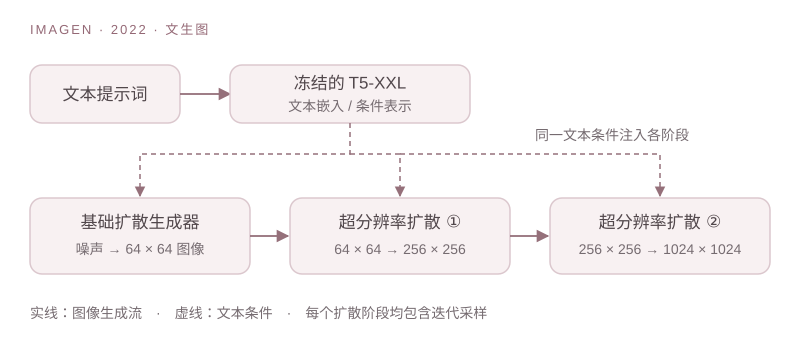
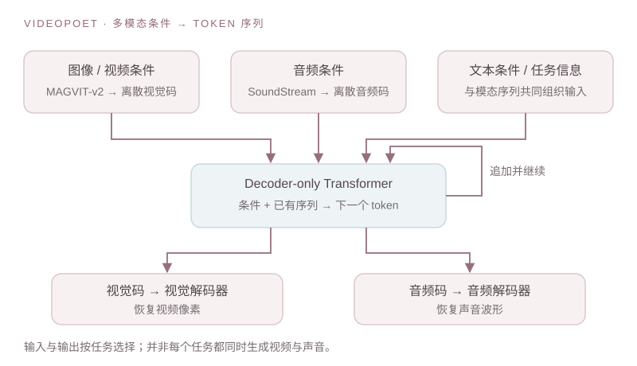
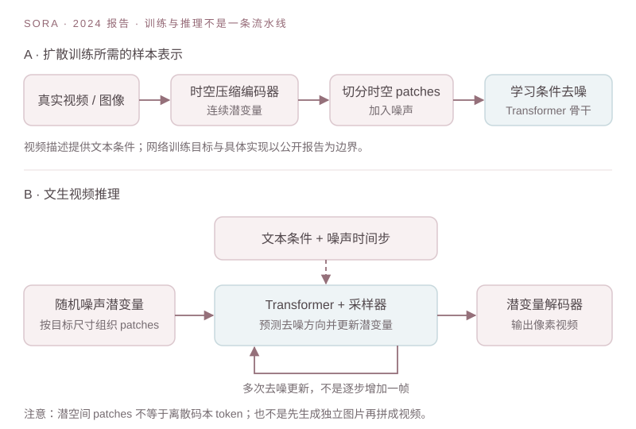

一段生成视频里，镜头可以穿过街道，人物可以转身，光影也像真的一样流动。然而，杯子可能突然改变形状，咬过的食物可能恢复完整，角色也可能在遮挡后换了一张脸。

这些错误指向同一个问题：**生成一组好看的画面，与生成一个持续自洽的过程，并不是同一件事。**

理解视频生成，可以先理清三件事：画面如何表示、生成过程如何学习，以及网络如何处理时空关系。沿着条件扩散、VideoPoet 和 Sora 这几条线索，就能把文本条件、视觉 token、去噪与时间一致性串起来。

## 1. 先拆开三个容易混淆的问题

谈论视频模型时，最常见的误区是把“扩散模型”和“Transformer”当成竞争路线。它们其实回答不同的问题。

| 层面 | 需要回答的问题 | 常见选择 |
| --- | --- | --- |
| 数据表示 | 模型处理什么？ | 像素、连续潜变量、离散视觉 token |
| 生成目标 | 模型如何学习生成？ | 逐步去噪、自回归预测 |
| 网络架构 | 用什么计算预测？ | U-Net、Transformer 或混合结构 |

**扩散是一种生成建模方法，Transformer 是一种神经网络架构。**同样的 Transformer 可以预测下一个离散 token，也可以在扩散模型中预测噪声或其他去噪目标。DiT 就是把 Transformer 用作潜空间扩散模型骨干的代表性工作。[\[DiT\]](https://arxiv.org/abs/2212.09748){.citation-link}

GAN、VAE 也不是被“彻底淘汰”的前代技术。例如，自编码器可以承担压缩与重建，而扩散网络负责在压缩后的空间里生成。理解现代系统时，与其寻找一位赢家，不如看清组件如何协作。

从 Runway、Pika 等早期视频生成产品，可以观察到一个共同难点：单帧质量已经较好时，连续片段仍可能出现身份漂移、物体变形和接触错误。视频长度增加后，这些小误差还会在时间上累积。

三种常见任务也需要分开：**文生视频**主要由文本约束场景与事件；**图生视频**把输入图像作为外观或起始状态条件；**视频到视频**则可能保留原片段的结构或运动，同时修改风格、内容。Runway Gen-1 的公开介绍强调根据源视频结构，利用文本或图像条件重新合成视频，而不是简单地对每一帧独立运行文生图。[\[Gen-1\]](https://runway.com/research/gen-1){.citation-link}

## 2. 扩散：学会去噪，而不是逐帧擦出视频

### 训练和生成，方向恰好相反

训练时，我们从真实样本出发，按噪声水平加入随机噪声，再让网络学习恢复信息。以 DDPM 的常见写法为例：

$$
x_t=\sqrt{\bar\alpha_t}\,x_0+\sqrt{1-\bar\alpha_t}\,\epsilon,
\qquad \epsilon\sim\mathcal N(0,I).
$$

这里，$x_0$ 是干净样本，$t$ 是**扩散时间步**，$\bar\alpha_t$ 控制信号与噪声的比例。训练并不一定要每次完整走过整条加噪链；可以采样一个噪声水平，构造对应的训练样本。

生成时则从噪声出发，反复调用网络和采样器，逐步得到符合条件的新样本。网络并不是到数据库里搜索碎片再拼贴，也不是一次减法就能普遍还原完整图像。[\[DDPM\]](https://arxiv.org/abs/2006.11239){.citation-link}

### 视频里有两条不同的“时间轴”

视频自己的时间表示“第一帧、第二帧……”，扩散时间表示“当前噪声有多大”。**一次去噪更新可以同时更新一段视频的表示；一次去噪并不等于生成下一帧。**具体模型也可以采用分块或自回归的生成策略，不能把某一种实现当作所有视频扩散模型的规则。

```{=html}
<section class="explainer" data-demo="diffusion" aria-label="去噪时间与视频时间的交互示意">
  <div class="explainer-label">INTERACTIVE FIGURE · 01</div>
  <h3>两条时间轴，各管一件事</h3>
  <p>拖动去噪进度，观察整段画面一起变清晰；改变视频时刻，只改变球的位置。</p>
  <div class="demo-controls">
    <label>去噪进度 <output data-noise-value>65%</output><input data-noise type="range" min="0" max="100" value="65" aria-label="去噪进度"></label>
    <label>视频时刻 <output data-frame-value>第 2 / 4 帧</output><input data-frame type="range" min="0" max="3" value="1" aria-label="视频帧"></label>
  </div>
  <canvas width="720" height="260" role="img" aria-label="四帧中球向右移动，去噪进度控制四帧共同的噪声强度"></canvas>
  <p class="demo-result" aria-live="polite">去噪更新整段视频，视频时间描述物体运动。</p>
  <p class="demo-note">教学示意：使用程序绘制的球与固定噪声混合，不是神经网络推理或实际去噪轨迹。</p>
  <noscript>本图需要 JavaScript。文字结论：去噪时间控制清晰程度，视频时间控制运动，两者相互独立。</noscript>
</section>
```

### 文本如何影响画面？

文本编码器把提示词转换成条件表示，生成网络在采样过程中利用这些条件。早期 Imagen 展示了文本编码器与级联扩散生成器的组合，但它是文生图工作，不能直接用来解释所有文生视频系统。[\[Imagen\]](https://arxiv.org/abs/2205.11487){.citation-link}

Imagen 的流程可以概括为：**冻结的 T5-XXL 编码器 → 64×64 基础图像 → 256×256 超分辨率 → 1024×1024 超分辨率**。两个超分阶段也使用文本条件，在逐步增加分辨率的同时补充与描述一致的细节。例如，“a boy is riding on a rocket”不仅包含“男孩”和“火箭”两个对象，还包含“骑在……上”的关系；文本条件需要同时约束对象及其空间关系。[\[Imagen\]](https://imagen.research.google/){.citation-link}

```{=html}
<figure class="architecture-figure">
  <div class="diagram-scroll" tabindex="0" role="region" aria-label="Imagen 架构图，可横向滚动"></div>
  <figcaption>图 1 · Imagen（2022）的级联文生图结构。箭头区分图像流与共享文本条件；这是图像模型，不包含视频时间建模。</figcaption>
</figure>
```

为了降低高分辨率计算成本，可以先把画面编码到更紧凑的潜空间，再在潜空间里生成，最后解码回像素。这样的压缩节省计算，但也意味着最终细节受编码器和解码器的能力约束。[\[Latent Diffusion\]](https://arxiv.org/abs/2112.10752){.citation-link}

### 扩散模型的优势与计算成本

扩散方法的一个优势是把生成学习转化为不同噪声水平下的预测问题，避开 GAN 中生成器与判别器的对抗博弈。去噪网络既可以使用 U-Net，也可以使用 Transformer。训练稳定性、样本质量和数据覆盖仍受损失函数、网络容量与训练数据影响。

其主要推理代价来自反复计算去噪网络。增加采样步数与画质之间不是无限单调的关系，训练目标、采样器与蒸馏方法都会影响成本。训练成本则还取决于模型规模、数据规模和分辨率，不能笼统写成“扩散必然比其他模型训练更贵”。

## 3. 自回归：把视觉内容写成序列

另一类方法先把视觉内容编码成离散 token，再像语言建模那样预测后续 token：

$$
p(z_1,\ldots,z_N\mid c)=\prod_{i=1}^{N}p(z_i\mid z_{<i},c).
$$

$z_i$ 是视觉或其他模态的 token，$c$ 表示条件。**视觉 token 不是自然语言单词，也不必对应一整帧。**它可能代表压缩后的一个局部视觉单元。

VideoPoet 使用 decoder-only Transformer 进行多模态自回归建模，支持文本、图像、视频和音频等条件。它说明语言建模范式可以扩展到视频，但这不意味着生成视频必须先把画面翻译成人类语言。[\[VideoPoet\]](https://arxiv.org/abs/2312.14125){.citation-link}

具体来说，视觉内容经 **MAGVIT-v2** 编码成离散码，音频经 **SoundStream** 编码；模型在给定文本或其他模态条件的情况下生成视觉、音频 token，再由对应解码器恢复内容。项目展示了续写、补全、风格转换和视频配音等组合任务。这里的“多模态”不是一个附加的调色步骤，而是训练任务与序列表示的共同设计。[\[VideoPoet\]](https://sites.research.google/videopoet/){.citation-link}

```{=html}
<figure class="architecture-figure">
  <div class="diagram-scroll" tabindex="0" role="region" aria-label="VideoPoet 架构图，可横向滚动"></div>
  <figcaption>图 2 · VideoPoet 的多模态生成接口。输入模态按任务选择，不要求每次全部提供；图中省略了任务标记及具体序列排布。</figcaption>
</figure>
```

这一路线的优势是序列建模接口统一；挑战则包括视觉序列长、逐步解码的时延，以及错误可能沿着已生成上下文继续传播。扩散采样也需要多次网络计算，因此“谁更快”必须在相同分辨率、长度、质量和硬件下比较，不能只凭架构名称下结论。

## 4. Sora 初代：把两种想法接起来

2024 年的 Sora 报告公开了一个关键组合：先把视频压缩到潜空间，再切分为时空 patches，用 Transformer 进行文本条件扩散建模。连续潜变量的 patch 虽然充当 Transformer token，却不等于自回归模型中的离散码本索引。报告未公开完整实现细节。[\[Sora Technical Report\]](https://openai.com/index/video-generation-models-as-world-simulators/){.citation-link}

```{=html}
<figure class="architecture-figure">
  <div class="diagram-scroll" tabindex="0" role="region" aria-label="Sora 训练与生成流程，可横向滚动"></div>
  <figcaption>图 3 · Sora 初代的训练与推理流程。训练从真实视频构造带噪潜变量；生成从噪声开始，在文本条件下循环去噪，最后解码为视频。</figcaption>
</figure>
```

另一个重要环节是**数据描述的质量**。Sora 初代借鉴 DALL·E 3 的重标注思路，训练视频描述模型，为训练视频生成详细描述；推理时还使用 GPT 扩写用户的短提示词。前者改善训练数据中的视频—文本对应关系，后者把简短指令展开为更充分的生成条件。视频描述由专门训练的描述模型完成，而非由 DALL·E 3 直接处理。[\[Sora Technical Report\]](https://openai.com/index/video-generation-models-as-world-simulators/){.citation-link}

这里更值得关注的不是“谁发明了某个模块”，而是**统一表示如何让不同长宽比、分辨率与时长的数据参与同一个学习过程**。同时，注意力有助于建立远距离关联，但它本身不是物体恒常性、因果推理或物理定律的保证。

## 5. 为什么多一个时间维度，会难这么多？

一张图可以把问题藏在某个瞬间；视频会把错误连续展示出来。判断视频质量，至少要同时看四层一致性。

| 一致性 | 要维持什么？ | 一个简单检查 |
| --- | --- | --- |
| 外观 | 身份、纹理、服装等属性 | 人物转身后是否还是同一个人？ |
| 几何 | 视角、遮挡、空间关系 | 镜头移动后，桌腿位置是否自洽？ |
| 动力学 | 运动、碰撞、接触关系 | 球撞到墙后是否合理改变方向？ |
| 事件 | 动作导致的持久变化 | 撕开的纸是否又无故恢复完整？ |

计算量也是瓶颈。若压缩后的视频有 $T'\times H'\times W'$ 个位置，并按大小为 $p_t\times p_h\times p_w$ 的 patch 切分，那么 token 数近似为：

$$
N\approx\frac{T'H'W'}{p_tp_hp_w}.
$$

对朴素全注意力而言，注意力矩阵规模随 $N^2$ 增长。保持其他条件不变，仅把时长翻倍，token 数约翻倍，注意力矩阵元素数约变成四倍。这个推导只适用于全注意力的该部分开销；稀疏注意力、分解时空注意力和高效实现会改变实际成本，不能直接把它当作整机显存预测。

更大的显存能缓解资源限制，却不会自动解决训练数据缺少动作因果信息、长时记忆不稳或分布外泛化的问题。

**Scaling 的作用需要放回整个系统中理解。**DiT 的实验展示了增加计算规模带来的图像生成指标改善。迁移到视频后，模型还要处理更长的时空序列；压缩表示、数据覆盖、描述质量、优化方法与采样预算共同决定最终效果。

## 6. 后续版本：从能生成，到可控制、可听见

截至 2026 年 8 月 5 日，视频生成的迭代重点已经从单纯提高画质，逐渐扩展到运动一致性、指令遵循、音视频同步和编辑流程。

| 系列与时间 | 相比早期版本的公开改进 | 技术要点与资料 |
| --- | --- | --- |
| Imagen（2022）→ Imagen 4（2025-05） | 官方强调图像细节、文字渲染和生成速度的改进 | 初代采用级联扩散；Imagen 4 的完整架构未公开。[\[Imagen 4\]](https://blog.google/innovation-and-ai/products/generative-media-models-io-2025/){.citation-link} |
| Sora 初代（2024-02）→ Sora Turbo（2024-12） | Turbo 重点提升生成速度，并进入面向用户的产品阶段 | 从研究展示走向产品化，速度成为重要优化方向。[\[Sora Turbo\]](https://openai.com/index/sora-is-here/){.citation-link} |
| Sora 2（2025-09） | 官方强调更好的物理表现、多镜头可控性，以及同步语音、音效等音视频生成能力 | 重点转向音视频协同与多镜头控制；完整架构未披露。[\[Sora 2\]](https://openai.com/index/sora-2/){.citation-link} |
| Runway Gen-1 / Gen-2 → Gen-4.5（2025-12） | 从早期视频转换与条件生成，推进到更强的运动质量、指令遵循和时间一致性 | 公开说明将改进归于预训练数据效率与后训练。[\[Gen-4.5\]](https://runway.com/research/introducing-runway-gen-4.5){.citation-link} |
| Google Veo 3.1（2025-10，作为补充对照） | 在 Veo 3 基础上加强音频、叙事控制与图生视频能力，并配合 Flow 编辑流程 | 与 VideoPoet 分属不同系列，重点是音视频生成与编辑工作流。[\[Veo 3.1\]](https://blog.google/technology/ai/veo-updates-flow/){.citation-link} |

这些变化意味着，评价生成工具时需要同时考虑画质、运动、声音和交互控制。对于实际创作，重试次数、局部修改能力与生成成本同样重要。

VideoPoet 和 Veo 适合从不同角度学习：前者提供多模态离散 token 与自回归建模的公开架构案例，后者展示音视频生成和创作工具的产品演进；它们属于不同模型系列。

产品状态方面，Sora 网页与 App 已于 **2026 年 4 月 26 日**停止服务。研究报告中的模型方法与面向用户的服务属于不同层面，阅读版本演进时可以分别记录技术变化和产品状态。[\[Sora Service Update\]](https://help.openai.com/en/articles/20001152-what-to-know-about-the-sora-discontinuation){.citation-link}

## 7. 视频生成的评估维度

看一段生成视频时，可以按以下四项做记录：

1. **检查连续性。**遮挡前后、接触前后、镜头切换前后，哪些状态应当保持？
2. **检查可控性。**只改变一个条件，结果是否按预期改变，其他因素是否尽量稳定？
3. **检查选择偏差。**是否说明采样次数、失败样本、剪辑方式和人工干预？
4. **检查应用指标。**创作工具关心可编辑性和成本，控制系统则必须关心预测误差及其安全后果。

数据与使用方式也是评估的一部分：训练数据会影响人物与文化呈现，逼真音视频可能被用于深度伪造或脱离上下文传播。发布生成内容时，生成标记、素材授权和编辑记录有助于追踪来源。

## 8. 总结：视频生成的知识框架

这部分学习可以归纳为五个要点：

1. **表示、目标与架构是三个层面。**像素、潜变量和离散 token 决定数据表示；扩散与自回归决定生成方式；Transformer 是实现预测的网络架构。
2. **视频时间与扩散时间相互独立。**前者描述运动过程，后者描述噪声水平；一次去噪可以更新整段视频的表示。
3. **条件信息决定生成的可控程度。**Imagen 用文本条件贯穿级联生成，VideoPoet 统一多模态序列，Sora 用详细视频描述和提示词扩写强化条件信息。
4. **时空压缩降低成本，也引入表示约束。**更长、更清晰的视频需要更多 token，既考验计算资源，也考验细节重建与长期状态保持。
5. **视频质量是多维度的。**外观、几何、动力学和事件一致性需要分别观察，再结合可编辑性、失败率和成本评价工具。

生成视频是一个强大的视觉建模问题，但它与“建立可靠世界模拟器”之间还隔着动作控制、长期一致性和可验证性。下一篇[《世界模型：从看见未来，到选择行动》](../2026-08-05-world-models/index.html)继续讨论这道边界。

## 来源与延伸阅读

节目笔记：[\[硅谷 101：视频生成模型发展史\]](https://www.bilibili.com/video/BV14F4m1c7RC){.citation-link}。

- 理解去噪目标：[\[DDPM\]](https://arxiv.org/abs/2006.11239){.citation-link}。
- 理解压缩与网络结构：[\[[Latent Diffusion](https://arxiv.org/abs/2112.10752){.citation-link}、[DiT](https://arxiv.org/abs/2212.09748){.citation-link}\]]{.citation-group}。
- 比较两种生成范式：[\[[VideoPoet](https://arxiv.org/abs/2312.14125){.citation-link}、[Sora Technical Report](https://openai.com/index/video-generation-models-as-world-simulators/){.citation-link}\]]{.citation-group}。
