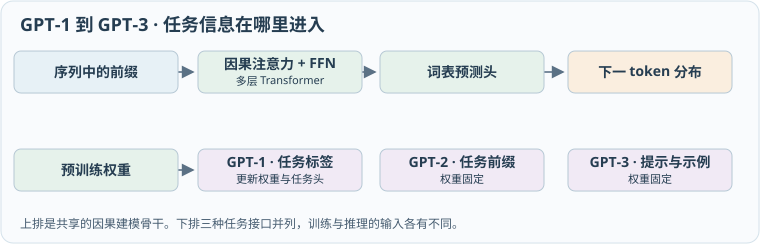
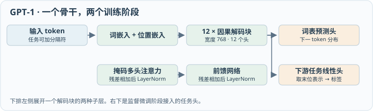
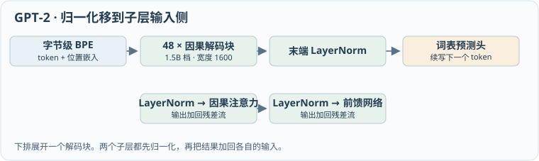
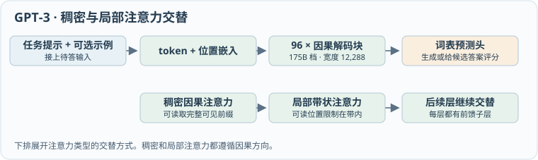
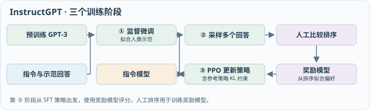
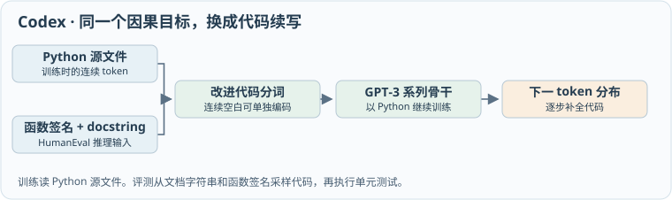
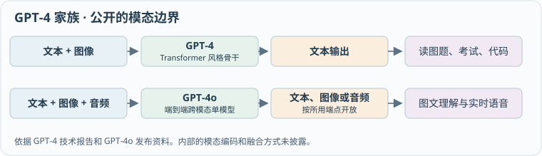
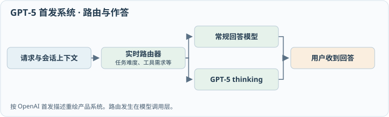
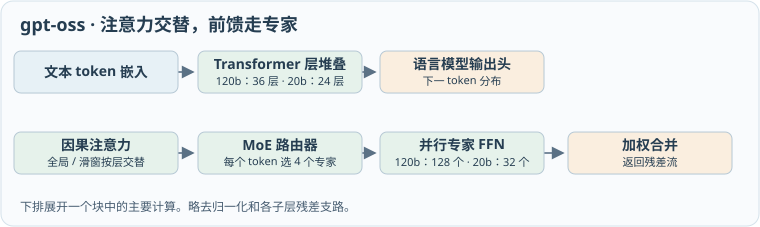
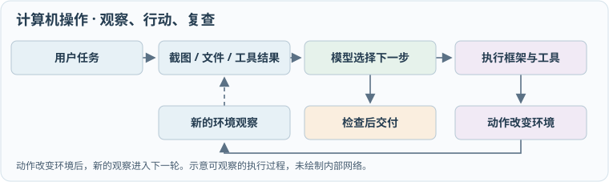

```{=html}
<link rel="stylesheet" href="assets/gpt-notes.css">
```

## 时间轴

GPT‑1 在任务数据上更新权重，GPT‑3 把任务示例放进提示，InstructGPT 把人类偏好放进后训练。到了 GPT‑6 Astra，一次回答还可能包含屏幕观察、工具调用与结果验证。比较这些变化时，可以分别问三件事：**权重怎样得到、推理时给了什么信息、模型能否向外部环境采取行动。**

```{=html}
<div class="gpt-timeline" role="region" aria-label="GPT 系列时间轴，可横向滚动" tabindex="0">
  <ol>
    <li><a href="#gpt1">GPT‑1</a><span class="model-meta">OpenAI · 2018.06</span><span>生成式预训练 → 任务微调</span></li>
    <li><a href="#gpt2">GPT‑2</a><span class="model-meta">OpenAI · 2019.02</span><span>放大预训练，直接做零样本任务</span></li>
    <li><a href="#gpt3">GPT‑3</a><span class="model-meta">OpenAI · 2020.05</span><span>175B 参数，上下文学习</span></li>
    <li><a href="#codex">Codex</a><span class="model-meta">OpenAI · 2021.07</span><span>代码补全与可执行评测</span></li>
    <li><a href="#instructgpt">InstructGPT</a><span class="model-meta">OpenAI · 2022.01</span><span>从人类偏好学习指令行为</span></li>
    <li><a href="#gpt35">GPT‑3.5 / ChatGPT</a><span class="model-meta">OpenAI · 2022.11</span><span>把对话纳入训练与产品接口</span></li>
    <li><a href="#gpt4">GPT‑4</a><span class="model-meta">OpenAI · 2023.03</span><span>图像输入与可预测的训练扩展</span></li>
    <li><a href="#gpt4-long">GPT‑4 Turbo</a><span class="model-meta">OpenAI · 2023.11</span><span>128K 上下文与函数调用</span></li>
    <li><a href="#gpt4o">GPT‑4o</a><span class="model-meta">OpenAI · 2024.05</span><span>端到端图像、语音与文本</span></li>
    <li><a href="#o-series">o1</a><span class="model-meta">OpenAI · 2024.09</span><span>推理训练与作答预算</span></li>
    <li><a href="#gpt45">GPT‑4.5</a><span class="model-meta">OpenAI · 2025.02</span><span>扩展无监督训练</span></li>
    <li><a href="#gpt4-long">GPT‑4.1</a><span class="model-meta">OpenAI · 2025.04</span><span>百万 token 上下文</span></li>
    <li><a href="#gpt-oss">gpt‑oss</a><span class="model-meta">OpenAI · 2025.08</span><span>开放权重与 MoE 配置</span></li>
    <li><a href="#gpt5">GPT‑5</a><span class="model-meta">OpenAI · 2025.08</span><span>快速回答、深度推理与路由</span></li>
    <li><a href="#gpt5-variants">GPT‑5.6</a><span class="model-meta">OpenAI · 2026.07</span><span>Sol、Terra、Luna 分档</span></li>
    <li><a href="#gpt6">GPT‑6 Astra</a><span class="model-meta">OpenAI · 2026.09.03</span><span>跨软件执行、检查与修正</span></li>
    <li><a href="#gpt6-sol-luna">GPT‑6 Sol / Luna</a><span class="model-meta">OpenAI · 2026.09.22</span><span>通用推理与高频任务分档</span></li>
    <li><a href="#gpt61-sol">GPT‑6.1 Sol</a><span class="model-meta">OpenAI · 2026.09.29</span><span>持续编码与跨软件执行</span></li>
    <li><a href="#gpt61-terra">GPT‑6.1 Terra</a><span class="model-meta">OpenAI · 2026.10.26</span><span>视觉定位与计算机操作</span></li>
    <li><a href="#gpt6-rosalind">GPT‑6 Rosalind Research</a><span class="model-meta">OpenAI · 2026.10.30</span><span>生命科学研究专门版</span></li>
  </ol>
</div>
```

## GPT‑1 至 GPT‑3：怎样把预训练能力用到新任务

| 模型 | 新任务的信息从哪里来 | 做新任务时改权重吗 |
| --- | --- | --- |
| GPT‑1 | 下游标注集与任务输出头 | 监督微调时更新 |
| GPT‑2 | 任务描述或能让文本续写对应到任务的前缀 | 论文零样本协议不更新 |
| GPT‑3 | 指令，以及可选的少数输入—输出示例 | 上下文学习只改变本次输入 |

::: {.gpt-diagram tabindex="0"}

:::

### GPT‑1 {#gpt1}

[OpenAI · 2018.06]{.model-meta}

::: {.gpt-diagram tabindex="0"}

:::

- **功能**　以同一个文本骨干适配分类、文本蕴含、相似度和阅读理解。
- **预训练任务**　根据此前 token 预测下一 token。监督微调时用末位表示接任务头，并可加语言建模辅助损失。
- **训练数据**　BooksCorpus，超过 7,000 本书。OpenAI 首发记载约 5 GB 文本，论文未给出实际采样 token 数。
- **训练超参**　预训练 100 个 epoch，连续片段长 512 token，每批 64 段。Adam 峰值学习率 $2.5\times10^{-4}$，预热 2,000 步后余弦衰减。骨干为 12 层、宽度 768、12 个注意力头，FFN 宽度 3072。
- **训练硬件**　OpenAI 首发记载在一台 8 GPU 机器上预训练约一个月。 [GPT‑1 Launch, Compute](https://openai.com/index/language-unsupervised/#compute)
- **推理任务**　按任务序列化输入。多选问答分别给每个候选项打分，文本蕴含和分类从任务头读取标签。论文在 12 项下游任务中有 9 项超过当时采用的对照结果。

::: {.article-equation}
$$
\mathcal{L}_{\mathrm{LM}}=-\sum_t\log p_\theta(x_t\mid x_{<t}).
$$
:::

和 BERT 相比，GPT‑1 的注意力有因果方向。BERT 在预测被遮 token 时能利用它两侧的上下文。 [GPT‑1 Paper, Sections 3–4, Figure 1, and Tables 1–3](https://cdn.openai.com/research-covers/language-unsupervised/language_understanding_paper.pdf) · [BERT Paper, Section 3](https://arxiv.org/abs/1810.04805)

### GPT‑2 {#gpt2}

[OpenAI · 2019.02]{.model-meta}

::: {.gpt-diagram tabindex="0"}

:::

- **功能**　用文本前缀把语言建模接口用于问答、摘要和翻译。
- **预训练任务**　保持下一 token 预测。字节级 BPE 词表有 50,257 项，归一化改到子层输入侧，最后一层后再加 LayerNorm。
- **训练数据**　WebText 由 Reddit 上达到筛选阈值的外链页面构建，清理后超过 800 万篇文档、约 40 GB。
- **训练超参**　上下文 1024 token，论文给出 batch size 512。学习率在 5% WebText 验证集上选择，论文未列具体值。最大档为 48 层、宽度 1600、约 1.54B 参数。
- **训练硬件**　OpenAI 原论文未列硬件。Andrej Karpathy 的公开复盘记录了 32 枚 TPU v3 芯片和 168 小时训练。 [GPT‑2 Training Retrospective](https://github.com/karpathy/nanochat/blob/master/dev/LEADERBOARD.md)
- **推理任务**　论文按零样本协议固定权重，用前缀触发文本续写或对候选答案评分。在 8 个语言建模数据集中的 7 个报告当时更好的结果。

[GPT‑2 Paper, Sections 2–4](https://cdn.openai.com/better-language-models/language_models_are_unsupervised_multitask_learners.pdf)

### GPT‑3 {#gpt3}

[OpenAI · 2020.05]{.model-meta}

::: {.gpt-diagram tabindex="0"}

:::

- **功能**　从提示里的少量示例学习标签和输出格式，完成翻译、问答和文本补全等任务。
- **预训练任务**　自回归预测下一个 token。GPT‑2 式骨干在各层交替使用稠密和局部带状稀疏注意力。
- **训练数据**　从过滤的 Common Crawl、WebText2、Books1、Books2 和 Wikipedia 按权重采样。175B 版训练约 300B token。
- **训练超参**　175B 版为 96 层、宽度 12,288、96 个注意力头，上下文 2048。全局 batch 从 32K 逐步增至 3.2M token，峰值学习率 $6\times10^{-5}$。采用 Adam，前 375M token 线性预热，余弦衰减至峰值的 10%，梯度范数上限 1.0，权重衰减 0.1。
- **训练硬件**　在 Microsoft 提供的高带宽集群上使用 NVIDIA V100，沿模型深度和宽度并行。论文未列该次运行的卡数。
- **推理任务**　zero-shot 只给任务说明，one-shot 给一个示例，few-shot 给多个示例。三者都固定权重。LAMBADA 的准确率依次为 76.2%、72.5%、86.4%，不同设置下的提示格式也有差别。

[GPT‑3 Paper, Sections 2–5 and Appendix B](https://arxiv.org/html/2005.14165)

## GPT‑3.5 与对齐：怎样把续写器变成助手

| 环节 | 给模型或训练器什么 | 得到什么 |
| --- | --- | --- |
| 预训练 | 文本、代码等序列 | 会预测后续 token 的基础模型 |
| 监督微调（SFT） | 指令及期望回答 | 学习对话、指令格式和示范行为 |
| 偏好训练（InstructGPT） | 同一提示下多条回答的人类排序 | 奖励模型，再用 PPO 优化回答策略 |
| 上下文学习 | 当前提示中的指令和示例 | 本次推理的条件发生变化 |

::: {.gpt-diagram tabindex="0"}

:::

### Codex：代码任务的早期分支 {#codex}

[OpenAI · 2021.07]{.model-meta}

::: {.gpt-diagram tabindex="0"}

:::

- **功能**　从自然语言说明生成 Python 函数或补全现有代码。
- **预训练任务**　沿用 GPT‑3 的因果语言建模目标。主实验从预训练 GPT 权重出发，在 Python 代码上继续预测下一个 token。
- **训练数据**　过滤后的公开 GitHub Python 语料约 159 GB。代码训练共采样约 100B token。
- **训练超参**　沿用同规模 GPT 模型的学习率，线性预热 175 步后余弦衰减。Adam 的 $\beta_1=0.9$、$\beta_2=0.95$、$\epsilon=10^{-8}$，权重衰减 0.1。
- **训练硬件**　公开资料未给出训练加速器型号与卡数。
- **推理任务**　HumanEval 提供函数签名与 docstring，用单元测试给采样结果评分。12B 研究模型在 164 道题上达 28.8% pass@1。pass@k 随可尝试的样本数变化。

[Codex Paper, Section 3](https://arxiv.org/abs/2107.03374)

### InstructGPT {#instructgpt}

[OpenAI · 2022.01]{.model-meta}

- **功能**　通过人类示范和偏好排序改进指令遵循。
- **预训练任务**　底座沿用 GPT‑3 的下一 token 预测。新增训练为监督微调（SFT）、6B 奖励模型（RM）和带 KL 约束的 PPO。
- **训练数据**　SFT、RM、PPO 分别用约 13K、33K、31K 个训练提示。奖励阶段同一提示有多条候选回答。
- **训练超参**　以 175B 档为例，SFT 为 16 个 epoch、batch 8、初始学习率 $5.03\times10^{-6}$、残差 dropout 0.2。RM 训 1 个 epoch、batch 64、初始学习率 $9\times10^{-6}$。PPO 跑 256K episodes，batch 512、minibatch 64、KL 系数 0.02。
- **训练硬件**　GPT‑3 底座使用 V100。InstructGPT 论文未给出后训练加速器型号与卡数。
- **推理任务**　给出 API 指令，由对齐后的策略生成回答。论文中的人工偏好比较显示，1.3B InstructGPT 在该提示分布中优于 175B 基础 GPT‑3。

[InstructGPT Paper, Section 3 and Appendix C](https://arxiv.org/html/2203.02155)

### GPT‑3.5 与早期 ChatGPT {#gpt35}

[OpenAI · 2022.11]{.model-meta}

- **功能**　维持多轮对话、回应后续追问，GPT‑3.5 Turbo 将对话开放为 API。
- **预训练任务**　OpenAI 说明 ChatGPT 从 GPT‑3.5 底座微调。公开训练说明集中在对话 SFT、人工回复排序和 PPO。底座预训练目标未具体披露。
- **训练数据**　对话训练混合人工扮演两方写出的示范和转成对话格式的 InstructGPT 数据。规模未公开。
- **训练超参**　公开资料未给出学习率、全局 batch size 与训练步数。
- **训练硬件**　OpenAI 确认使用 Microsoft Azure AI 超算基础设施，未公布训练加速器型号与卡数。
- **推理任务**　把历史与当前输入作为有角色的消息序列，生成助手回复。2023 年 3 月 API 首发采用同一类交互格式。

[ChatGPT Launch and Methods](https://openai.com/index/chatgpt/) · [GPT‑3.5 Turbo API Launch](https://openai.com/index/introducing-chatgpt-and-whisper-apis/)

## GPT‑4 家族：视觉、长上下文与两条扩展路线

| 版本 | 主要改进 | 公开到什么程度 |
| --- | --- | --- |
| GPT‑4 | 图文输入、文本输出。报告给出训练损失的规模预测 | Transformer 风格、下一 token 训练、数据来源类别、RLHF |
| GPT‑4 Turbo / 4.1 | 更长上下文和改进的指令或代码处理 | 接口规格及长上下文、代码等基准 |
| GPT‑4o | 同一模型处理文字、视觉与声音，支持端到端音频 | 模态、数据类别、能力与安全评测 |
| GPT‑4.5 | 扩展无监督预训练，后训练着重交互行为 | 扩展方向、对齐方法的公开描述及评测 |

::: {.gpt-diagram tabindex="0"}

:::

### GPT‑4 {#gpt4}

[OpenAI · 2023.03]{.model-meta}

- **功能**　从文本或图像输入生成文本，可做读图、考试题和代码任务。
- **预训练任务**　技术报告确认 Transformer 风格的下一 token 预测，以及 RLHF 后训练。
- **训练数据**　公开和获许可的第三方数据。训练规模、数据构造和各来源比例未公开。
- **训练超参**　技术报告未公开学习率、批量和训练步数。报告用较小训练实验预测大模型最终代码验证损失，也预测部分 HumanEval 表现。
- **训练硬件**　技术报告未公开加速器型号、卡数或训练 FLOPs。
- **推理任务**　处理图文题、专业考试题和自然语言指令。模拟 Uniform Bar Examination 的成绩约为参考分布前 10%，这个百分位依赖题目和评分协议。

[GPT‑4 Technical Report, Sections 2–6](https://arxiv.org/html/2303.08774)

### GPT‑4 Turbo 与 GPT‑4.1 {#gpt4-long}

[OpenAI · 2023.11 / 2025.04]{.model-meta}

| 版本 | 功能 | 预训练任务与数据规模 | 训练超参与硬件 | 推理任务 |
| --- | --- | --- | --- | --- |
| GPT‑4 Turbo | 128K 上下文，改进函数调用和 JSON 模式 | 具体目标和规模未披露 | 学习率、批量、加速器及卡数未披露 | 在长文档上下文里问答，按结构输出或发起工具调用。 [GPT‑4 Turbo Launch](https://openai.com/index/new-models-and-developer-products-announced-at-devday/) |
| GPT‑4.1 / mini / nano | 系列支持约 100 万 token 上下文，分别覆盖质量、延迟和成本需求 | 具体目标和各型号数据规模未披露 | 学习率、批量、加速器及卡数未披露 | 长文档检索与综合、代码修改、精确遵循指令。GPT‑4.1 在首发 SWE-bench Verified 中达 54.6%。 [GPT‑4.1 Launch and Benchmarks](https://openai.com/index/gpt-4-1/) |

窗口大小决定能放进多少 token。长上下文评测则测模型能否从干扰信息中找到所需内容。

### GPT‑4o {#gpt4o}

[OpenAI · 2024.05]{.model-meta}

- **功能**　用一个端到端模型理解文本、图像和声音，生成文本或在相应端点生成音频和图像。
- **预训练任务**　官方披露端到端跨模态训练。分模态的目标、损失与权重未公开。
- **训练数据**　系统卡记载了公开及合作来源的文本、图像和音频等。模态比例和总量未公布。
- **训练超参**　公开资料未给出学习率、全局 batch size 与训练步数。
- **训练硬件**　公开资料未给出训练加速器型号与卡数。
- **推理任务**　图文问答或实时语音对话。首发演示中语音响应最快约 232 ms，平均约 320 ms。

[GPT‑4o Launch](https://openai.com/index/hello-gpt-4o/) · [GPT‑4o System Card](https://openai.com/index/gpt-4o-system-card/)

#### GPT‑4o mini

[OpenAI · 2024.07]{.model-meta}

- **功能**　以较低成本提供文本和视觉推理。首发报告 MMLU 82%。
- **预训练任务**　公开资料未给出可复现的预训练目标与损失配置。
- **训练数据**　公开资料未给出训练语料规模。
- **训练超参**　公开资料未给出学习率、全局 batch size 与训练步数。
- **训练硬件**　公开资料未给出训练加速器型号与卡数。
- **推理任务**　用文本或图像输入做问答、分类及工具调用。首发 API 接收文本与图像，生成文本。

[GPT‑4o mini Launch](https://openai.com/index/gpt-4o-mini-advancing-cost-efficient-intelligence/)

### GPT‑4.5 {#gpt45}

[OpenAI · 2025.02]{.model-meta}

- **功能**　通过扩大无监督训练改善知识覆盖、意图理解和对话协作。
- **预训练任务**　官方确认扩展无监督学习，并采用监督微调和 RLHF。预训练损失细节未公布。
- **训练数据**　发布资料未给出实际采样 token 数或语料构成比例。
- **训练超参**　公开资料未给出学习率、全局 batch size 与训练步数。
- **训练硬件**　公开资料未给出训练加速器型号与卡数。
- **推理任务**　用于日常问答、写作及分析。首发 SimpleQA 表列准确率 62.5%、幻觉率 37.1%，对应短事实问答这一协议。

[GPT‑4.5 Launch and Evaluation](https://openai.com/index/introducing-gpt-4-5/)

## o 系列与 GPT‑5：把推理时间变成一个可控变量

| 方法 | 改的是哪一层 | 应记录的设置 |
| --- | --- | --- |
| 扩展预训练 | 模型在大量数据上的权重 | 模型大小、实际 token 数、算力 |
| 推理后训练 | 模型解决问题、验证答案的行为 | 训练任务、奖励或验证方式、公开程度 |
| 推理预算 | 单次作答可消耗的计算 | 推理档位、采样数、时限 |
| 系统路由 | 请求交给哪条处理路径 | 产品模式、路由、工具和执行环境 |

::: {.gpt-diagram tabindex="0"}

:::

### o1、o3-mini、o3 与 o4-mini {#o-series}

[OpenAI · 2024.09 / 2025.01 / 2025.04]{.model-meta}

| 版本 | 功能 | 预训练任务与数据规模 | 训练超参与硬件 | 推理任务 |
| --- | --- | --- | --- | --- |
| o1 | 强化学习训练解题策略，可在单次作答上增加测试计算 | 底座目标与数据量未披露，官方说明推理强化学习随训练计算扩展 | 奖励细节、学习率、批量和训练卡数未披露 | 多步数学与代码推理。比较成绩时区分单次采样、多样本共识和重排序。 [Learning to Reason with LLMs](https://openai.com/index/learning-to-reason-with-llms/) |
| o3-mini · 2025.01 | 侧重 STEM 推理及成本效率 | 底座目标与数据量未披露 | 学习率、批量、加速器及卡数未披露 | 解决数学、科学和编程题，可配置推理档位。 [o3-mini Launch](https://openai.com/index/openai-o3-mini/) |
| o3 · 2025.04 | 结合视觉输入和工具做高难度推理 | 底座目标与数据量未披露，官方描述了推理与工具使用的训练 | 学习率、批量、加速器及卡数未披露 | 读图，按需执行搜索或 Python，把工具输出纳入后续推理。 [o3 and o4-mini Launch](https://openai.com/index/introducing-o3-and-o4-mini/) |
| o4-mini · 2025.04 | 在较小的推理模型上提供数学、代码和视觉能力 | 底座目标与数据量未披露 | 学习率、批量、加速器及卡数未披露 | 面向高频 STEM、视觉与工具任务，可用更多测试计算作答。 [o3 and o4-mini Launch](https://openai.com/index/introducing-o3-and-o4-mini/) |

推理后训练会更新权重。测试时增加推理预算会改变同一个模型解题时能用的计算量。工具结果则为后续步骤增加了新输入。

### GPT‑5 {#gpt5}

[OpenAI · 2025.08]{.model-meta}

- **功能**　在 ChatGPT 中按难度和工具需求，分派到快速回答或 GPT‑5 thinking。
- **预训练任务**　首发资料说明了路由、指令遵循、安全和减少迎合的训练，未给出完整底座预训练目标。
- **训练数据**　首发报告未给出底座训练语料规模或实际采样 token 数。
- **训练超参**　公开资料未给出学习率、全局 batch size 与训练步数。
- **训练硬件**　公开资料未给出训练加速器型号与卡数。
- **推理任务**　在日常问答、数学、图文理解、编码和工具任务中生成回答或发起工具调用。上方是官方首发产品的路由图。

[GPT‑5 Launch and System Card](https://openai.com/index/introducing-gpt-5/)

### GPT‑5.1 至 GPT‑5.6 {#gpt5-variants}

[OpenAI · 2025.11–2026.07]{.model-meta}

这些版本的底座预训练目标、学习率、全局批量、训练步数、加速器型号与卡数均未公开。公开的训练数据估算对应下表指明的型号。即时回答、推理档位和多智能体配置会改变单次推理过程。

| 版本 / 首发 | 功能 | 训练数据规模 | 推理任务与评测 |
| --- | --- | --- | --- |
| **GPT‑5.1 · 2025.11.12** | Instant 改进指令遵循，Thinking 更灵活地分配推理时间 | 未披露 | 日常对话及分析。简单题和难题分别观察延迟及推理档位。 [GPT‑5.1 System Card Addendum](https://openai.com/index/gpt-5-system-card-addendum-gpt-5-1/) |
| **GPT‑5.2 · 2025.12.11** | 分为 Instant、Thinking、Pro，强化长上下文和专业工具使用 | 文本 >10 万亿 token，见下表 | 处理多文档、表格、代码和专业交付。GDPval、代码与长上下文分开读。 [GPT‑5.2 Launch and Benchmarks](https://openai.com/index/introducing-gpt-5-2/) |
| **GPT‑5.3‑Codex · 2026.02.05** | 面向持续编码及工具使用 | 未披露 | 在终端里检查仓库、修改代码、执行并验证。 [GPT‑5.3-Codex Launch](https://openai.com/index/introducing-gpt-5-3-codex/) |
| **GPT‑5.3 Instant · 2026.03.03** | 调整对话风格和搜索结果组织 | 未披露 | 日常问答和结合搜索结果的多轮对话。 [ChatGPT Release Notes](https://help.openai.com/en/articles/6825453-chatgpt-release-notes) |
| **GPT‑5.4 · 2026.03.05** | 强化编码、视觉与计算机操作。mini 和 nano 于 3 月 17 日推出 | Nano 文本 >10 万亿 token。该区间来自 Nano 的训练内容摘要 | 读屏操作、代码和专业任务。mini 适合低延迟工具任务，nano 适合分类、提取和排序。 [GPT‑5.4 Launch](https://openai.com/index/introducing-gpt-5-4/) · [GPT‑5.4 Mini and Nano Launch](https://openai.com/index/introducing-gpt-5-4-mini-and-nano/) |
| **GPT‑5.5 · 2026.04.23** | 提升长流程任务的完成质量和输出效率 | 文本 >10 万亿 token，见下表 | 跨工具执行编码、专业或研究任务。比较完成率时也记录时长和输出量。 [GPT‑5.5 Launch and Benchmarks](https://openai.com/index/introducing-gpt-5-5/) |
| **GPT‑5.6 · 2026.07.09** | Sol、Terra、Luna 对应不同质量和成本档。Ultra 可协调多个智能体 | Luna 文本 >10 万亿 token。该区间来自 Luna 的训练内容摘要 | Sol 处理难题，Terra 平衡效率与质量，Luna 面向高频任务。DeepSWE v1.1 首发成绩依次为 72.7%、69.6%、67.2%。 [GPT‑5.6 Launch and Benchmarks](https://openai.com/index/gpt-5-6/) |

训练内容摘要给出按模态估算的语料区间。部分音视频以字幕、转写或元数据参与。训练采样总量和 API 支持的输入输出需另外核对。

| 训练内容摘要 | 文本 | 图像 | 音频 | 视频 |
| --- | --- | --- | --- | --- |
| [GPT‑5.2 Training Content Summary](https://cdn.openai.com/pdf/gpt-5-2-eu-ai-act-public-summary-of-training-content.pdf) | >10 万亿 token | >10 亿张 | >100 万小时 | 1 万至 100 万小时 |
| [GPT‑5.4 Nano Training Content Summary](https://cdn.openai.com/pdf/gpt-5-4-nano-eu-ai-act-public-summary-of-training-content.pdf) | >10 万亿 token | >10 亿张 | <1 万小时 | <1 万小时 |
| [GPT‑5.5 Training Content Summary](https://cdn.openai.com/pdf/gpt-5-5-eu-ai-act-public-summary-of-training-content.pdf) | >10 万亿 token | >10 亿张 | >100 万小时 | >100 万小时 |
| [GPT‑5.6 Luna Training Content Summary](https://cdn.openai.com/pdf/gpt-5-6-luna-eu-ai-act-public-summary-of-training-content.pdf) | >10 万亿 token | >10 亿张 | >100 万小时 | >100 万小时 |

### gpt‑oss：可以对照权重和配置的公开分支 {#gpt-oss}

[OpenAI · 2025.08]{.model-meta}

::: {.gpt-diagram tabindex="0"}

:::

- **功能**　提供可下载权重的文本推理模型，支持代码、数学、结构化输出和工具使用。120b 与 20b 总参数约 116.8B 与 20.9B，每 token 激活约 5.1B 与 3.6B。
- **预训练任务**　自回归预测文本 token。后训练加入可调推理预算、工具使用和强化学习。
- **训练数据**　两档均在数万亿量级文本 token 上预训练，包含 STEM、编程和通识。分型号实际采样总量未公布。
- **训练超参**　模型卡披露架构、分词与推理设置，未给出完整的预训练学习率、批量及步数。
- **训练硬件**　120b 约用 210 万 NVIDIA H100 GPU 小时，20b 约少一个数量级。模型卡未列并发训练卡数。
- **推理任务**　在固定权重上选择推理档位，生成文本或调用外部工具。AIME、Codeforces 和 SWE-bench Verified 结果按推理与工具配置读取。

[gpt‑oss Model Card, Section 2](https://arxiv.org/html/2508.10925)

## GPT‑6：从作答到在软件里执行任务

| 型号 | 技术重点 | 推理时的典型输入 → 输出 |
| --- | --- | --- |
| Astra | 视觉定位与长流程工具执行 | 目标、截图、工具观察 → 一连串操作及结果 |
| Sol / Luna | 将同代推理方法用于不同成本档 | 图文、指令 → 推理文本或工具动作 |
| 6.1 Sol | 改进持续编码及跨软件执行 | 任务、项目状态、测试结果 → 修订后的交付物 |
| 6.1 Terra | 强化视觉推理及计算机操作 | 截图、界面状态 → 定位与后续操作 |
| Rosalind Research | 复用 Astra 权重，配合生命科学工具及访问控制 | 研究问题与专业材料 → 研究分析 |

::: {.gpt-diagram tabindex="0"}

:::

### GPT‑6 Astra {#gpt6}

[OpenAI · 2026.09.03]{.model-meta}

- **功能**　理解截图、操作软件，并在跨步骤任务中检查和修正结果。API 文本及图像输入、文本输出，上下文约 1.05M token。
- **预训练任务**　系统卡描述了预训练数据构成改进，也报告强化学习评分和跨步骤安全训练的改进。预训练损失与内部网络结构未披露。
- **训练数据**　摘要估算文本 >10 万亿 token、图像 >10 亿张、音频和视频各 >100 万小时。部分音视频用字幕、转写或元数据表示。
- **训练超参**　公开资料未给出学习率、全局 batch size 与训练步数。
- **训练硬件**　公开资料未给出训练加速器型号与卡数。
- **推理任务**　先读目标与当前环境，选择工具或动作，再读取反馈决定继续、修正还是交付。执行框架提供工具、传递结果并管理权限。

[Astra System Card, Model Data and Training](https://deploymentsafety.openai.com/gpt-6-astra) · [Astra Training Content Summary](https://cdn.openai.com/pdf/gpt-6-astra-eu-ai-act-public-summary-of-training-content.pdf) · [Astra Model Reference](https://developers.openai.com/api/docs/models/gpt-6-astra)

**评测。** 下表沿用 Astra 首发的评测配置。ScreenSpot-Pro 无工具，OSWorld 2.0 采用离线子集及部分得分。Terminal-Bench 的 4.0 和 2.1 是不同基准版本。 [Astra Launch Benchmarks and Footnotes](https://openai.com/index/gpt-6-astra/)

| 指标 | GPT‑5.6 Sol | GPT‑6 Astra |
| --- | ---: | ---: |
| ScreenSpot-Pro，无工具 | 76.9% | 92.7% |
| OSWorld 2.0，离线子集，部分得分 | 65.7% | 72.6% |
| Terminal-Bench 4.0 | 37.3% | 57.9% |
| DeepSWE v1.1 | 72.7% | 74.1% |

Astra Pro 随首发提供给部分 ChatGPT 方案。发布页列出了该选项，训练内容摘要记录的是 Astra 的配置。 [Astra Launch and Availability](https://openai.com/index/gpt-6-astra/)

### GPT‑6 Sol 与 Luna {#gpt6-sol-luna}

[OpenAI · 2026.09.22]{.model-meta}

| 型号 | 功能 | 预训练任务与数据规模 | 训练超参与硬件 | 推理任务 |
| --- | --- | --- | --- | --- |
| GPT‑6 Sol | 面向专业工作、编码和计算机操作的通用推理档 | 官方称训练方法与 Astra 类似，未披露独立预训练损失和数据量 | 学习率、批量、加速器及卡数未公开 | 接收文本和图像，处理代码、读图或多步工具任务。首发 DeepSWE v1.1 在最大推理档达 68.8% |
| GPT‑6 Luna | 更强调成本和速度的推理档 | 官方称训练方法与 Astra 类似，未披露独立预训练损失和数据量 | 学习率、批量、加速器及卡数未公开 | 接收文本和图像，处理频繁的问答、阅读与工具任务 |

10 月 7 日，OpenAI 的系统卡记录了 ChatGPT 中 Sol、Luna 的更新及安全评测变化。比较结果时，需区分 ChatGPT 的更新和更早的 API 版本。 [GPT‑6 Sol and Luna Launch](https://openai.com/index/introducing-gpt-6-sol-and-luna/) · [GPT‑6 October System Card](https://deploymentsafety.openai.com/gpt-6-october/avoiding-deceptive-interactions-with-users)

### GPT‑6.1 Sol {#gpt61-sol}

[OpenAI · 2026.09.29]{.model-meta}

- **功能**　进一步改进持续编码、软件操作和专业工作。
- **预训练任务**　公开资料未给出可复现的预训练目标与损失配置。
- **训练数据**　公开资料未给出训练语料规模。
- **训练超参**　公开资料未给出学习率、全局 batch size 与训练步数。
- **训练硬件**　公开资料未给出训练加速器型号与卡数。
- **推理任务**　在编码或专业工作环境中多轮读取状态、使用工具、修订结果并验证。首发 OSWorld 2.0 离线子集的部分得分，在最大推理档比 GPT‑6 Sol 高 7 个百分点。

[GPT‑6.1 Sol Launch and Benchmarks](https://openai.com/index/introducing-gpt-6-1-sol/) · [GPT‑6.1 Sol System Card Addendum](https://deploymentsafety.openai.com/gpt-6-1-sol)

### GPT‑6.1 Terra {#gpt61-terra}

[OpenAI · 2026.10.26]{.model-meta}

- **功能**　强化视觉推理与计算机操作。
- **预训练任务**　公开资料未给出可复现的预训练目标与损失配置。
- **训练数据**　摘要估算文本 >10 万亿 token、图像 >10 亿张、音频和视频各 >100 万小时。包含公开、合作、合成及人工内容，部分音视频以文本表示。
- **训练超参**　公开资料未给出学习率、全局 batch size 与训练步数。
- **训练硬件**　公开资料未给出训练加速器型号与卡数。
- **推理任务**　从截图定位元素，根据操作反馈推进任务。首发 Terminal-Bench 4.0 在最大推理档解决 50.3% 的任务，发布页列出的 GPT‑5.6 Terra 对照为 21.5%。

[GPT‑6.1 Terra Launch](https://openai.com/index/introducing-gpt-6-1-terra/) · [Terra Training Content Summary](https://cdn.openai.com/pdf/gpt-6-1-terra-eu-ai-act-public-summary-of-training-content.pdf)

### GPT‑6 Rosalind Research {#gpt6-rosalind}

[OpenAI · 2026.10.30]{.model-meta}

- **功能**　在受限部署中用科学工具辅助多步生命科学研究。
- **预训练任务**　系统卡确认与 [GPT‑6 Astra](#gpt6) 使用相同权重，预训练目标沿用 Astra 的披露范围。
- **训练数据**　沿用 Astra 的语料和估算区间。此次发布没有追加训练数据或后训练。
- **训练超参与硬件**　沿用 Astra。官方未公开其学习率、批量、训练步数和加速器卡数。
- **推理任务**　给定研究问题及材料，辅助分析、解释和规划。官方系统卡另列部署条件与生物安全评测。

[GPT-Rosalind-6 System Card Addendum](https://deploymentsafety.openai.com/gpt-rosalind-6) · [OpenAI Release Notes](https://openai.com/products/release-notes/)

## 放到语言模型的发展史里读

| 研究线索 | 代表工作 | 帮助解释的变化 |
| --- | --- | --- |
| 双向表征 | Google AI Language 的 **BERT**（2018） | 掩码预测可以同时利用左右上下文，适合研究理解任务与迁移。 [BERT Paper](https://arxiv.org/abs/1810.04805) |
| 文本到文本 | Google Research 的 **T5**（2019 预印本） | 把分类、翻译和摘要都转成生成文本，并系统比较目标、数据与迁移方法。它采用编码器—解码器。 [T5 Paper](https://arxiv.org/abs/1910.10683) |
| 计算量如何分配 | DeepMind 的 **Chinchilla**（2022） | 在其比较的固定训练算力下，更小模型配更多 token 可以更优。它把训练 token 量和参数量放进同一个实验设计。 [Chinchilla Paper](https://arxiv.org/abs/2203.15556) |
| 可验证推理 | DeepSeek 的 **R1‑Zero / R1**（2025） | R1‑Zero 试验直接强化学习，R1 加入冷启动数据和分阶段训练。开放报告有助于对照推理训练的实验变量。 [DeepSeek-R1 Paper](https://arxiv.org/abs/2501.12948) |

如果想接着看同一个 Transformer 骨干怎样进入图像、视频和三维几何，可以顺着视觉 token、交叉注意力与训练目标继续读。 [从 Transformer 到视觉与多模态基础模型](../2026-09-12-transformer/index.html)
