```{=html}
<link rel="stylesheet" href="assets/transformer-figures.css?v=4">
<script src="assets/transformer-demos.js?v=3" defer></script>
```

## 时间轴

一张图可以被切成序列，用于分类、生成、分割或三维重建。把这些模型放在一起读，先看 **输入怎样变成 token、token 之间能怎样交换信息、训练时究竟预测什么**。横向滑动时间轴，点击模型可跳到对应图解。

```{=html}
<div class="tf-timeline" role="region" aria-label="Transformer 里程碑，可横向滚动" tabindex="0">
<ol>
<li><a href="#原始-transformer">Transformer</a><span class="model-meta">Google Brain、Google Research、多伦多大学 · 2017.06</span><span>并行翻译训练</span></li>
<li><a href="#gpt">GPT / GPT-3</a><span class="model-meta">OpenAI · 2018.06 / 2020.05</span><span>因果语言预训练与少样本提示</span></li>
<li><a href="#bert">BERT</a><span class="model-meta">Google AI Language · 2018.10</span><span>双向上下文</span></li>
<li><a href="#detr">DETR</a><span class="model-meta">Facebook AI Research（FAIR） · 2020.05</span><span>把检测写成集合预测</span></li>
<li><a href="#vit">ViT</a><span class="model-meta">Google Research · 2020.10</span><span>把图像变成 patch 序列</span></li>
<li><a href="#clip">CLIP</a><span class="model-meta">OpenAI · 2021.02</span><span>图文双塔对齐</span></li>
<li><a href="#swin">Swin Transformer</a><span class="model-meta">微软亚洲研究院 · 2021.03</span><span>窗口注意力与多尺度特征</span></li>
<li><a href="#mae">MAE</a><span class="model-meta">Facebook AI Research · 2021.11</span><span>只编码可见 patch</span></li>
<li><a href="#videomae">VideoMAE</a><span class="model-meta">南京大学、腾讯 AI Lab、上海人工智能实验室 · 2022.03</span><span>沿时间遮住同一位置</span></li>
<li><a href="#flamingo">Flamingo</a><span class="model-meta">DeepMind · 2022.04</span><span>语言层交叉读取视觉记忆</span></li>
<li><a href="#dit">DiT</a><span class="model-meta">加州大学伯克利分校、纽约大学、Meta FAIR · 2022.12</span><span>用 Transformer 替代扩散骨干中的 U-Net</span></li>
<li><a href="#llava">LLaVA</a><span class="model-meta">威斯康星大学麦迪逊分校、微软研究院、哥伦比亚大学 · 2023.04</span><span>把图像特征接到语言输入</span></li>
<li><a href="#sam">SAM</a><span class="model-meta">Meta AI Research · 2023.04</span><span>用提示选出对象</span></li>
<li><a href="#dinov2">DINOv2 与 DINOv3</a><span class="model-meta">Meta AI Research · 2023.04 / 2025.08</span><span>从全图特征到稠密特征</span></li>
<li><a href="#dust3r">DUSt3R</a><span class="model-meta">阿尔托大学、NAVER LABS Europe · 2023.12</span><span>从两张照片直接回归点图</span></li>
<li><a href="#videopoet">VideoPoet</a><span class="model-meta">Google Research · 2023.12</span><span>用同一个因果模型生成视频和音频 token</span></li>
<li><a href="#sora">Sora</a><span class="model-meta">OpenAI · 2024.02 技术报告</span><span>把不同时长、画幅的视频表示为时空 patch</span></li>
<li><a href="#sd3">Stable Diffusion 3</a><span class="model-meta">Stability AI · 2024.03 论文</span><span>MMDiT 让图像和文本在联合注意力中交换信息</span></li>
<li><a href="#llama">Llama 3.1</a><span class="model-meta">Meta · 2024.07</span><span>GQA 与开放权重</span></li>
<li><a href="#sam2">SAM 2</a><span class="model-meta">Meta AI Research · 2024.07 首发，08 预印本</span><span>把提示传播到视频</span></li>
<li><a href="#deepseek">DeepSeek-V3 / R1</a><span class="model-meta">DeepSeek · 2024.12 / 2025.01</span><span>稀疏专家与推理后训练</span></li>
<li><a href="#wan">Wan2.1 与 Wan2.2</a><span class="model-meta">阿里巴巴 Wan 团队 · 2025.02 首发、03 报告 / 2025.07</span><span>开放视频生成权重与去噪分工</span></li>
<li><a href="#vggt">VGGT</a><span class="model-meta">牛津大学 Visual Geometry Group、Meta AI · 2025.03</span><span>多张图一次前向预测</span></li>
<li><a href="#vjepa">V-JEPA 2</a><span class="model-meta">Meta FAIR · 2025.06</span><span>预测视频特征，并用于动作规划</span></li>
<li><a href="#qwen3-vl">Qwen3-VL</a><span class="model-meta">阿里巴巴 Qwen 团队 · 2025.09</span><span>视觉特征注入多个语言层</span></li>
<li><a href="#sam3">SAM 3</a><span class="model-meta">Meta AI Research · 2025.11</span><span>用概念找全实例</span></li>
<li><a href="#ltx">LTX-2</a><span class="model-meta">Lightricks · 2026.01 报告</span><span>同一个去噪过程联合生成画面和音轨</span></li>
<li><a href="#vggt-omega">VGGT-Ω</a><span class="model-meta">牛津大学 Visual Geometry Group、Meta AI · 2026.05</span><span>用 register 汇集跨视图信息</span></li>
</ol>
</div>
```

正文选取截至 **2026 年 9 月 12 日** 已发布、能代表一种设计路线的工作。日期采用预印本或产品首发，存在差异时注明。成绩沿用各论文的模型版本、数据划分和评测协议。架构图沿用论文图或按公开结构重绘。总览按设计问题并排比较，同一行中的模型可体现设计变化。交互图进入视野后播放一轮，也可以用按钮手动切换。VGGT-Ω 的评测另附一条有日期的复现更新。

## 原始 Transformer

[Google Brain、Google Research、多伦多大学 · 2017.06]{.model-meta}

::: {.tf-architecture}
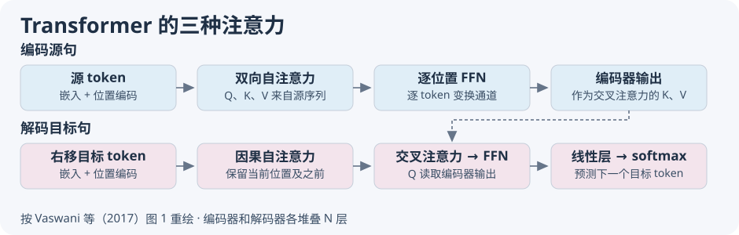
:::

机器翻译模型把源句与右移一位的目标句分别送入编码器和解码器。以矩阵形式看，注意力做的是一次带权读取：

::: {.article-equation}
$$
\mathrm{Attention}(Q,K,V)=\mathrm{softmax}\!\left(\frac{QK^\top}{\sqrt{d_k}}+M\right)V.
$$
:::

每个 query 与所有允许读取的 key 计算分数，再用归一化权重汇总 value。自注意力的 $Q,K,V$ 来自同一个序列的不同线性投影。交叉注意力的 $Q$ 来自解码器，$K,V$ 来自编码器。多头注意力并行计算多组投影，再拼接并映射回模型宽度。注意力在 token 间交换信息，逐位置 FFN 对每个 token 独立做通道变换。原始模型用残差、Post-LayerNorm 和正弦位置编码，Base 为 6 层编码器加 6 层解码器、宽度 512、8 个头、FFN 宽度 2048。[原论文 §3、图 1](https://arxiv.org/abs/1706.03762)

| 注意力 | Q 来自 | K、V 来自 | 可以读取 |
| --- | --- | --- | --- |
| 编码器自注意力 | 源序列 | 源序列 | 全部有效源位置 |
| 解码器因果自注意力 | 右移后的目标序列 | 同一目标序列 | 当前和之前的输入位置 |
| 编解码交叉注意力 | 解码器中间状态 | 最后一层编码器输出 | 全部有效源位置 |

原论文训练用 WMT 2014 英→德（约 450 万句对、约 3.7 万共享 BPE 词表）和英→法（约 3600 万句对、约 3.2 万 word-piece 词表）。用 Adam、4000 步 warm-up 和标签平滑。Big 在 8 张 P100 上训练约 3.5 天，测试采用 beam search，束宽 4、长度惩罚 0.6。Big 的英→德结果为 **28.4 BLEU**，英→法取 arXiv 修订版表 2 的 **41.8 BLEU**。NeurIPS 会议版摘要写的是 41.0，引用时要注明版本。 [arXiv §5–6、表 2](https://arxiv.org/abs/1706.03762v7) · [NeurIPS 版本](https://papers.neurips.cc/paper/7181-attention-is-all-you-need.pdf)

### Transformer 中的一些问题

| 问题 | 机制 |
| --- | --- |
| 解码器能并行吗？ | Teacher forcing 提供完整的右移目标序列，掩码在 softmax 前把未来位置设为负无穷，训练可并行计算各位置。自回归推理仍要逐步生成。KV cache 可复用过去 token 的投影。 |
| 为什么要除以 $\sqrt{d_k}$？ | 若分量近似独立且方差为 1，点积方差随 $d_k$ 增长。缩放控制 logits 的典型量级，减轻 softmax 饱和。同一 token 的注意力权重也未必最高。 |
| LayerNorm、Dropout 和标签平滑怎样算？ | Transformer 通常按每个 token 的隐藏维度求 LayerNorm，除数是 $\sqrt{\sigma^2+\epsilon}$。Inverted dropout 保留项乘 $1/(1-p)$。标签平滑 $\epsilon_{ls}=0.1$ 表示混入约 10% 的平滑分布，目标类别仍约有 90% 的质量。 |
| 全局注意力对长序列有何代价？ | 长度 $n$、宽度 $d$ 时，全局注意力的两次矩阵乘约为 $O(n^2d)$，标准投影另需 $O(nd^2)$。所有位置可在单层直接通信。视觉窗口、视频压缩和长上下文稀疏注意力分别缩小可见范围或减少参与计算的 token。 |

原论文 §5.4 给出 Base 的 residual dropout 为 **0.1**。它施加于各子层输出和残差相加之前，也施加于词嵌入与位置编码相加之后。表 3 的 Big 设定列出 **0.3**，§6.1 单独注明英→法 Big 使用 **0.1**。这两个概率描述的是不同实验配置。 [原论文 §5.4、§6.1 与表 3](https://arxiv.org/abs/1706.03762v7)

## 图像表征与感知

```{=html}
<figure class="tf-overview">
<figcaption>图像表征与感知 · 结构、训练目标与输出的变化</figcaption>
<div class="tf-route"><strong>注意力与尺度</strong><ul><li><a href="#vit">ViT</a><span>全局 patch 交互</span></li><li><a href="#swin">Swin</a><span>局部窗口 + 多尺度</span></li></ul></div>
<div class="tf-route"><strong>自监督表征</strong><ul><li><a href="#mae">MAE</a><span>重建被遮像素</span></li><li><a href="#dinov2">DINOv2 / v3</a><span>教师特征 → 局部关系约束</span></li></ul></div>
<div class="tf-route"><strong>集合检测</strong><ul><li><a href="#detr">DETR</a><span>查询输出一组框</span></li></ul></div>
<div class="tf-route"><strong>提示分割</strong><ul><li><a href="#sam">SAM</a><span>提示选 mask</span></li><li><a href="#sam2">SAM 2</a><span>记忆传播到视频</span></li><li><a href="#sam3">SAM 3</a><span>找出概念匹配的实例</span></li></ul></div>
</figure>
```

图像模型可以输出一个分类结果、一组检测框、每个 patch 的特征，或用户指定对象的像素掩码。看架构图时，先找到输出头，再沿箭头往前找这些输出从哪里读取信息。

### DETR {#detr}

[Facebook AI Research（FAIR） · 2020.05]{.model-meta}

::: {.tf-architecture}
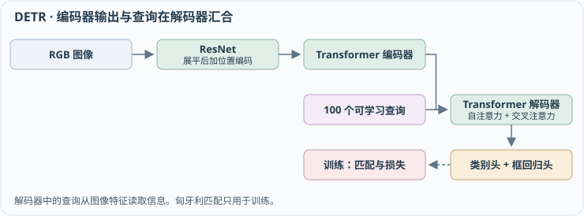
:::

**为什么一张图可以直接输出一组框？** 每个查询占一个槽，一对一匹配让不同槽负责不同物体，多余的槽预测空项。

**训练**　匈牙利匹配把预测槽与标注物体一对一分配。类别用分类损失，匹配到的框用 L1 与 GIoU 损失。训练使用 COCO 2017 的约 11.8 万张训练图。

**评测**　原始 ResNet-50 配置训练 500 个 epoch，在 COCO val2017 得到 **42.0 box AP**。测试流程直接输出集合，省去 NMS。 [论文 §3–4、表 1](https://arxiv.org/abs/2005.12872)

### ViT {#vit}

[Google Research · 2020.10]{.model-meta}

::: {.tf-architecture}
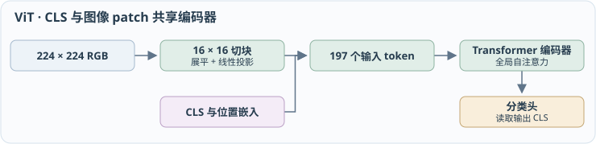
:::

**分类和分割读的是同一份输出吗？** 分类头读 CLS。要保留位置，就读取对应各图像块的 patch token，SAM 再用提示选择具体对象。

ViT-B/16 的 196 个 patch 加一个 CLS，共 197 个 token。

**训练**　论文比较 ImageNet-1K、ImageNet-21k 和私有 JFT-300M 预训练，再迁移到 ImageNet、CIFAR 和 VTAB。

**评测**　表 2 的 **ViT-H/14** 在 JFT-300M 预训练后，以 518×518 输入微调，ImageNet Top-1 为 **88.55%**。这个数值对应 H/14，图里的切块示例采用更易算的 B/16。 [论文 §3–4、表 2](https://arxiv.org/abs/2010.11929)

### Swin Transformer {#swin}

[微软亚洲研究院 · 2021.03]{.model-meta}

::: {.tf-architecture}
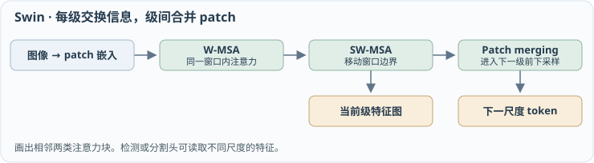
:::

**窗口变小后，跨窗口的信息怎么传？** 移位改变窗口边界，让下一层读到原先被分隔的邻居。

全局注意力的配对数随 token 数平方增长。Swin 固定窗口大小，使每层的配对成本随图像 token 数近似线性增长。分阶段合并 patch 提供多尺度特征，便于接检测或分割头。

**训练**　论文用 ImageNet-1K 或 22K 做监督预训练。

**评测**　Swin-L 在 ImageNet-22K 预训练后报 **87.3% ImageNet-1K Top-1**，搭配检测或分割系统分别达到 **58.7 COCO test-dev box AP** 和 **53.5 ADE20K val mIoU**。 [论文 §3–4、表 1–4](https://openaccess.thecvf.com/content/ICCV2021/html/Liu_Swin_Transformer_Hierarchical_Vision_Transformer_Using_Shifted_Windows_ICCV_2021_paper.html)

```{=html}
<figure class="tf-demo" data-tf-demo="attention">
  <figcaption><strong>点选一个 patch，看它能读到哪里</strong><br>用简化的 8×8 网格比较 ViT 的全局读取与 Swin 的两种窗口。真实 Swin 使用循环移位和掩码，示意图直接画出图像边界内的有效范围。</figcaption>
  <div class="tf-buttons" role="group" aria-label="注意力范围">
    <button type="button" data-step="global" aria-pressed="true">ViT 全局</button>
    <button type="button" data-step="window" aria-pressed="false">Swin 窗口</button>
    <button type="button" data-step="shift" aria-pressed="false">移位窗口</button>
    <button type="button" data-play>播放</button>
  </div>
  <span class="tf-play-state" data-play-state>待播放 · 1 / 3</span>
  <div class="tf-patch-grid" data-grid role="group" aria-label="点选一个查询 patch，也可用方向键移动"></div>
  <output data-status aria-live="polite">全局注意力可访问全部 64 个 patch。</output>
</figure>
```

### MAE {#mae}

[Facebook AI Research · 2021.11]{.model-meta}

::: {.tf-architecture}
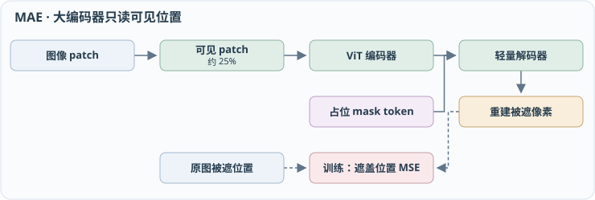
:::

**被遮块进入编码器吗？** 编码器只处理可见块。解码器在被遮位置补入占位 token，才恢复完整空间网格。

**训练**　预训练只用 ImageNet-1K 图像，重建损失直接来自原图。以 196 块为例，75% 遮盖时，大编码器只读 49 块。微调分类时移除轻量解码器，让编码器读取完整图像。

**评测**　论文的 ViT-H 在不加外部数据的条件下报告 **87.8% ImageNet-1K Top-1**。这个结果来自端到端微调，线性探测是论文中的另一项实验。 [论文 §3–4、表 3](https://arxiv.org/abs/2111.06377) · [官方实现与权重](https://github.com/facebookresearch/mae)

```{=html}
<figure class="tf-demo" data-tf-demo="mask">
  <figcaption><strong>比较遮盖比例与编码器输入量</strong><br>示意采用 ViT-B/16 的 14×14 patch 网格。灰色位置在解码端以 mask token 补回。</figcaption>
  <div class="tf-buttons" role="group" aria-label="遮盖比例">
    <button type="button" data-step="0" aria-pressed="true">不遮盖</button>
    <button type="button" data-step="50" aria-pressed="false">50%</button>
    <button type="button" data-step="75" aria-pressed="false">75%</button>
    <button type="button" data-play>播放</button>
  </div>
  <span class="tf-play-state" data-play-state>待播放 · 1 / 3</span>
  <div class="tf-mask-grid" data-grid aria-hidden="true"></div>
  <output data-status aria-live="polite">不遮盖时，196 个 patch 都进入编码器。</output>
</figure>
```

### DINOv2 与 DINOv3 {#dinov2}

[Meta AI Research · 2023.04 / 2025.08]{.model-meta}

::: {.tf-architecture}
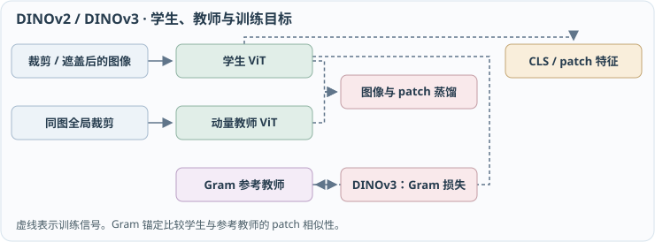
:::

**DINOv2** 将 DINO 的图像级自蒸馏和 iBOT 的遮盖 patch 目标放在一起，训练集是从大规模候选池筛出的 **LVD-142M**。教师参数由学生的指数移动平均更新。图像级目标让同一张图的不同裁剪具有相近的全图语义，patch 目标给学生局部监督。论文用冻结骨干测试 ImageNet 线性分类，也测试检索、语义分割与单目深度。 [DINOv2 报告 §3–6](https://arxiv.org/abs/2304.07193)

**DINOv3** 将自然图像训练扩到包含 **16.89 亿张 LVD-1689M 精选图片**的混合数据，并用 Gram 锚定改善长训练后局部特征退化。Gram 矩阵记录同一图内 patch 两两的相似性，约束它可以保住局部关系。报告在冻结骨干上接线性头，使用 ADE20K、Cityscapes、VOC 做分割，NYUv2 和 KITTI 做深度。图 9 的消融显示，加入 Gram 教师更新后，ADE20K 又提升约 **2 mIoU**，这是消融增量。 [DINOv3 报告 §3–6、图 9](https://arxiv.org/abs/2508.10104)

### SAM {#sam}

[Meta AI Research · 2023.04]{.model-meta}

::: {.tf-architecture}
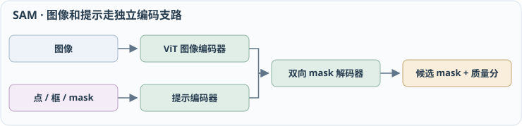
:::

提示与图像分开编码，因此交互中改一个点时可复用图像特征。

**训练**　数据引擎先人工辅助标注，再逐步扩大自动标注，得到 **SA-1B 的约 1100 万图、超过 10 亿个 mask**。训练模拟多轮提示，掩码用 focal 与 Dice 损失。

**评测**　论文的零样本单点实验覆盖 23 个数据集，并请标注者评估合理但与单一参考掩码不同的预测。 [论文 §3–7、图 8](https://arxiv.org/abs/2304.02643)

### SAM 2 {#sam2}

[Meta AI Research · 2024.07 首发，08 预印本]{.model-meta}

::: {.tf-architecture}
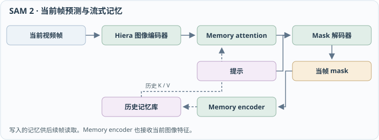
:::

SAM 2 把交互提示扩展到任意视频帧。记忆编码器把当前帧和掩码合成记忆，后续帧借此跟踪同一对象。

**训练**　训练混用图像与视频，数据引擎收集的 **SA-V 含 50.9K 视频与 642.6K masklets**。一个 masklet 是同一对象跨帧的一串掩码。

**评测**　官方仓库的 **SAM 2.1 Hiera-L** 在 SA-V test 得到 **79.5 J&F**。J 衡量区域重合，F 衡量边界匹配。 [论文 §4–6](https://arxiv.org/abs/2408.00714) · [SAM 2.1 官方表格](https://github.com/facebookresearch/sam2)

### SAM 3 {#sam3}

[Meta AI Research · 2025.11]{.model-meta}

::: {.tf-architecture}
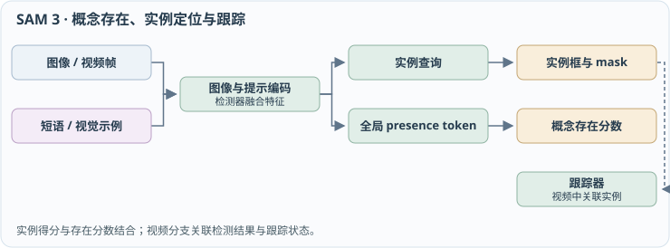
:::

**点一个杯子和输入「红色杯子」有什么区别？** 前者选一个实例，后者可能得到多个实例，也可能一个都没有。

**训练**　数据引擎使用困难负例，**SA-Co/HQ 含 520 万图，SA-Co/VIDEO 含 5.25 万视频**。

**评测**　SA-Co/Gold 把概念是否存在和实例定位一起测，论文的 cgF₁ 同时约束这两件事。消融表中，基础 SAM 3 在 SA-Co/Gold 为 **54.0 cgF₁**。 [论文 §3–6](https://arxiv.org/abs/2511.16719)

```{=html}
<figure class="tf-demo" data-tf-demo="prompts">
  <figcaption><strong>同一张图，换一种提示会选出几个对象？</strong><br>三个杯子是预先绘制的图形。切换选项可比较实例提示和概念提示的预期输出。</figcaption>
  <div class="tf-buttons" role="group" aria-label="输入提示">
    <button type="button" data-step="point" aria-pressed="true">点左边</button>
    <button type="button" data-step="concept" aria-pressed="false">红色杯子</button>
    <button type="button" data-step="missing" aria-pressed="false">黄色杯子</button>
    <button type="button" data-play>播放</button>
  </div>
  <span class="tf-play-state" data-play-state>待播放 · 1 / 3</span>
  <svg class="tf-prompt-scene" data-scene data-mode="point" viewBox="0 0 420 140" role="img" aria-label="左、右各一个红杯，中间是蓝杯。虚线标示被选中的杯子。">
    <defs><path id="tf-cup" d="M0 0h65v54a13 13 0 0 1-13 13H13A13 13 0 0 1 0 54Z M65 11h10a15 15 0 0 1 0 30H65"/></defs>
    <rect width="420" height="140" rx="9" fill="#edf3f8"/>
    <path d="M15 109H405" stroke="#a6b6c7" stroke-width="2"/>
    <g stroke="#273e53" stroke-width="2" stroke-linejoin="round">
      <use href="#tf-cup" x="36" y="41" fill="#b95768"/>
      <use href="#tf-cup" x="164" y="41" fill="#679fc3"/>
      <use href="#tf-cup" x="292" y="41" fill="#b95768"/>
    </g>
    <use class="tf-outline tf-left" href="#tf-cup" x="36" y="41"/>
    <use class="tf-outline tf-right" href="#tf-cup" x="292" y="41"/>
    <circle class="tf-point" cx="67" cy="73" r="6" fill="#161f36" stroke="white" stroke-width="2"/>
  </svg>
  <output data-status aria-live="polite">点提示选中一个实例：左边的红杯。</output>
</figure>
```

## 视频表征与三维几何

```{=html}
<figure class="tf-overview">
<figcaption>时空模型 · 两类输入、两类预测目标</figcaption>
<div class="tf-route"><strong>同一段视频</strong><ul><li><a href="#videomae">VideoMAE</a><span>遮盖 → 重建像素</span></li><li><a href="#vjepa">V-JEPA 2</a><span>遮盖 → 预测特征</span></li></ul></div>
<div class="tf-route"><strong>同一场景的视图</strong><ul><li><a href="#dust3r">DUSt3R</a><span>图对 → 点图</span></li><li><a href="#vggt">VGGT</a><span>多图 → 联合几何</span></li><li><a href="#vggt-omega">VGGT-Ω</a><span>跨视图交换 → 压缩到 register</span></li></ul></div>
</figure>
```

视频理解用跨帧信息学习动作和状态，三维重建用跨视角信息恢复相机和空间结构。一帧里的局部相似性、两帧里的时间相关性和多张图里的几何对应，分别对应不同的训练信号。

### VideoMAE {#videomae}

[南京大学、腾讯 AI Lab、上海人工智能实验室 · 2022.03]{.model-meta}

::: {.tf-architecture}
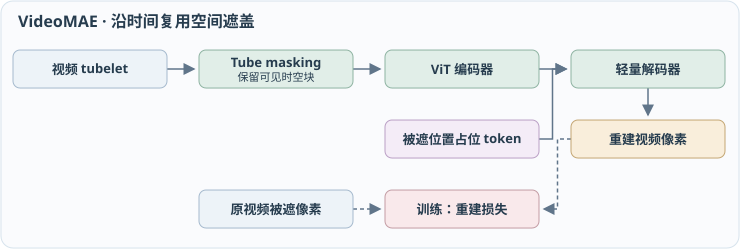
:::

**遮盖为什么沿时间重复？** 同一位置在临近帧中很相似。一起遮掉，可以减少直接复制像素的捷径。

**训练**　论文发现 **90%–95%** 的高遮盖率仍能有效学习。

**评测**　在对应视频数据上自监督预训练再微调、不用额外训练数据，论文报告 **87.4% Kinetics-400** 与 **75.4% Something-Something V2 Top-1**。后者常需区分方向相反的动作，更依赖时间顺序。 [论文 §3–4](https://arxiv.org/abs/2203.12602)

### V-JEPA 2 {#vjepa}

[Meta FAIR · 2025.06]{.model-meta}

::: {.tf-architecture}
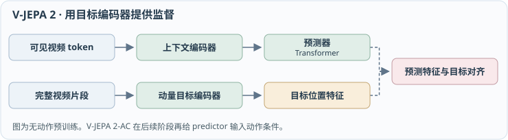
:::

**它和 VideoMAE 学的是同一个目标吗？** VideoMAE 重建像素，V-JEPA 2 预测目标编码器的特征。后者的动作规划也在特征空间比较候选结果。

**训练**　无动作预训练使用 **超过 100 万小时互联网视频**及图像。自监督目标是被遮区域的潜表示，模型可保留与运动有关的规律，不必逐像素重建。后续 V-JEPA 2-AC 使用 **约 62 小时 DROID** 机器人轨迹进行动作条件训练，再用候选动作预测未来表征并选接近目标的动作。

**评测**　报告给出 **77.3% SSv2 Top-1（ViT-g，attentive probe）** 与 **39.7% EPIC-KITCHENS-100 动作预判 recall@5**，机器人抓放是另一个实机评测。 [技术报告](https://arxiv.org/abs/2506.09985) · [Meta 项目说明](https://ai.meta.com/blog/v-jepa-2-world-model-benchmarks/)

### DUSt3R {#dust3r}

[阿尔托大学、NAVER LABS Europe · 2023.12]{.model-meta}

::: {.tf-architecture}
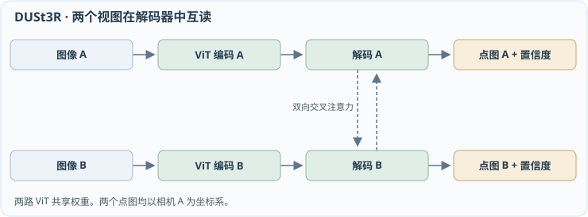
:::

两张点图都在第一台相机的坐标系里表达。模型学的是三维位置，后续才可从点图推导深度或相机姿态。

**训练**　论文使用 **约 850 万图对**，来自 Habitat、MegaDepth、ARKitScenes、Static Scenes 3D、BlendedMVS、ScanNet++、CO3D-v2 和 Waymo，用尺度归一化与置信度加权监督点图。

**评测**　评测包括 DTU 多视图重建、CO3D 位姿和 Map-free 重定位。单对前向预测和多图全局优化是不同的运行流程。 [CVPR 论文 §3–4、附录 F](https://openaccess.thecvf.com/content/CVPR2024/papers/Wang_DUSt3R_Geometric_3D_Vision_Made_Easy_CVPR_2024_paper.pdf)

### VGGT {#vggt}

[牛津大学 Visual Geometry Group、Meta AI · 2025.03]{.model-meta}

::: {.tf-architecture}
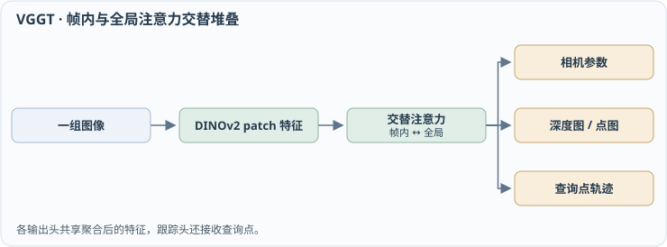
:::

**为什么它能同时估计相机与深度？** 每个输出头读取共享的多视图特征。DUSt3R 先做成对预测，多图场景还需要把点图对齐。

**训练**　训练在 CO3Dv2、MegaDepth、ScanNet、Hypersim、Kubric 等真实与合成数据上使用多任务几何监督。

**评测**　表 1 每场景随机取 10 张图，直接前向版在 RealEstate10K 与 CO3Dv2 的相对相机位姿 **AUC@30° 分别为 85.3、88.2**。表中的 BA 版本会再优化相机和几何，需单独比较。点图实验也区分直接点图头与「深度 + 相机」反投影。该工作获 CVPR 2025 最佳论文。 [论文 §3–4、表 1 与表 3](https://arxiv.org/abs/2503.11651) · [官方项目](https://github.com/facebookresearch/vggt)

### VGGT-Ω {#vggt-omega}

[牛津大学 Visual Geometry Group、Meta AI · 2026.05]{.model-meta}

::: {.tf-architecture}
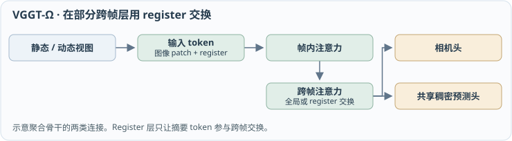
:::

**跨帧时一定要交换每个 patch 吗？** VGGT-Ω 在部分层让 register 交换摘要，普通 patch 通过其他注意力层获得信息。

VGGT-Ω 在部分层用少量 register 替换全图 token 的跨帧连接，并以共享稠密头减少高分辨率解码开销。

**训练**　监督数据来自公开与内部的真实、合成序列，公开来源包括 uCo3D、DL3DV、Dynamic Replica、ScanNet 和 Waymo。训练还对未标注视频用学生与动量教师做自蒸馏。

**评测**　论文测试 ETH3D 等静态场景和 Sintel、DyCheck 等动态场景。 [CVPR 2026 论文 §3–4](https://openaccess.thecvf.com/content/CVPR2026/papers/Wang_VGGT-ohm_CVPR_2026_paper.pdf)

**复现更新（2026.09.18）**。作者指定新重训权重作为今后对照的参考版本。重训从公开的 VGGT 权重初始化聚合器，跳过了自监督阶段。复现表中该权重在 Sintel 相机位姿测试得 **35.5 AUC@3°**，同表 VGGT 为 **16.2**。项目页提供原始与复现资料及可旋转的三维重建样例。 [官方项目与复现说明](https://vggt-omega.github.io/) · [重训记录](https://github.com/facebookresearch/vggt-omega/blob/main/reproduction.md)

```{=html}
<figure class="tf-demo" data-tf-demo="views">
  <figcaption><strong>切换帧内、全局和 register 交换</strong><br>每张卡片代表一个视角。彩色区域表示参与本步注意力的 token。Register 模式只演示 VGGT-Ω 使用这种注意力的层。</figcaption>
  <div class="tf-buttons" role="group" aria-label="交换方式">
    <button type="button" data-step="local" aria-pressed="true">帧内</button>
    <button type="button" data-step="global" aria-pressed="false">跨视图</button>
    <button type="button" data-step="register" aria-pressed="false">Register</button>
    <button type="button" data-play>播放</button>
  </div>
  <span class="tf-play-state" data-play-state>待播放 · 1 / 3</span>
  <div class="tf-views" data-mode="local" data-views>
    <div class="tf-view"><strong>视图 A</strong><span>patch tokens</span><b>register</b></div>
    <div class="tf-view"><strong>视图 B</strong><span>patch tokens</span><b>register</b></div>
    <div class="tf-view"><strong>视图 C</strong><span>patch tokens</span><b>register</b></div>
  </div>
  <output data-status aria-live="polite">查询来自视图 A，只读取 A 的图像 token。</output>
</figure>
```

## 图像与视频生成

```{=html}
<figure class="tf-overview">
<figcaption>生成模型 · 按输出表示和条件接口对比</figcaption>
<div class="tf-route"><strong>离散 token</strong><ul><li><a href="#videopoet">VideoPoet</a><span>逐 token 生成，最后解码</span></li></ul></div>
<div class="tf-route"><strong>连续图像 latent</strong><ul><li><a href="#dit">DiT</a><span>类别条件调制</span></li><li><a href="#sd3">SD3</a><span>图文流联合注意力</span></li></ul></div>
<div class="tf-route"><strong>连续时空 latent</strong><ul><li><a href="#sora">Sora</a><span>时空 patch</span></li><li><a href="#wan">Wan2.2</a><span>按时间步选专家</span></li><li><a href="#ltx">LTX-2</a><span>音画双流相互读取</span></li></ul></div>
</figure>
```

生成模型先选输出表示。连续路线在 VAE 潜空间里逐步更新整个样本，离散路线可以把画面和声音量化成 token 后逐个生成。DiT、SD3 和 Sora 都使用 Transformer 处理连续潜空间，但它们的训练目标和条件注入方式各不相同。

### DiT {#dit}

[加州大学伯克利分校、纽约大学、Meta FAIR · 2022.12]{.model-meta}

::: {.tf-architecture}
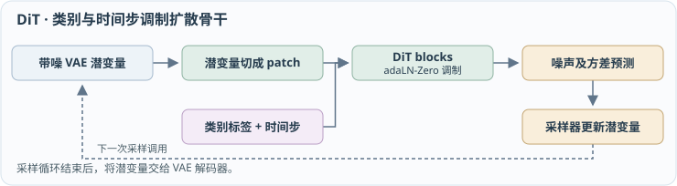
:::

**生成一步会产生一个 patch 吗？** DiT 一次预测所有位置的更新量，采样器反复更新同一份连续潜变量。

**训练**　原版是 **ImageNet 类条件**模型，类别标签和时间步调节 Transformer 残差分支，最后预测噪声和学习到的方差。论文比较模型深宽、潜空间 patch 大小与计算量。

**评测**　DiT-XL/2 在 **256×256 ImageNet、50,000 个生成样本、250 步、CFG 1.5** 的配置下报告 **FID 2.27**。FID 越低，生成分布在所用特征空间里越接近参考分布。项目页还展示了 512×512 模型的潜空间插值动画。 [论文 §3–4、表 2](https://arxiv.org/abs/2212.09748) · [作者项目页与动画](https://www.wpeebles.com/DiT.html)

### VideoPoet {#videopoet}

[Google Research · 2023.12]{.model-meta}

::: {.tf-architecture}
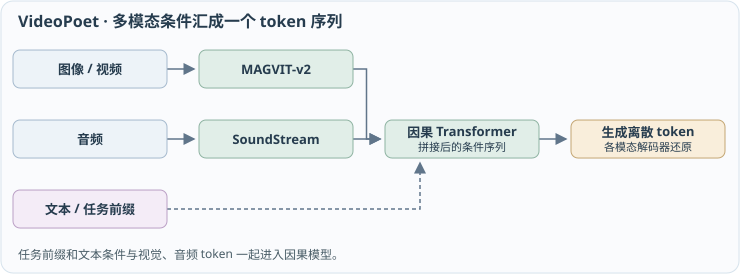
:::

**它与 DiT 的采样区别在哪？** VideoPoet 按顺序追加离散 token，最后统一解码。DiT 则反复更新完整的连续潜变量。

VideoPoet 以 MAGVIT-v2 表示图像和视频，以 SoundStream 表示音频。

**训练**　论文披露约 **10 亿图文对、2.7 亿视频**，涵盖配文字或配音轨的素材。先混合预训练，再针对文生视频、编辑、补全和视频转音频适配。同一段可见视频可以既作为补全的前缀，也作为生成对应音轨的条件。

**评测**　零样本评测用 MSR-VTT、UCF-101 做文生视频，用 Kinetics-600 的前 5 帧预测后 11 帧，另报告人类偏好。 [论文 §3–4](https://arxiv.org/abs/2312.14125)

### Sora {#sora}

[OpenAI · 2024.02 技术报告]{.model-meta}

::: {.tf-architecture}
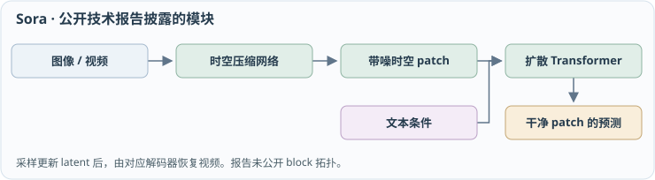
:::

**训练**　Sora 联合训练不同时长、分辨率和长宽比的图像与视频，并给训练视频生成更详细的描述。

**评测**　报告展示了可变画幅、图生视频和前后延伸，也展示了碰撞、因果和物体状态出错的案例。**报告以定性样例为主**，未提供层数、训练数据清单和规模，也没有供跨模型复现的统一分数。 [OpenAI 技术报告](https://openai.com/index/video-generation-models-as-world-simulators/)

### Stable Diffusion 3 {#sd3}

[Stability AI · 2024.03 论文]{.model-meta}

::: {.tf-architecture}
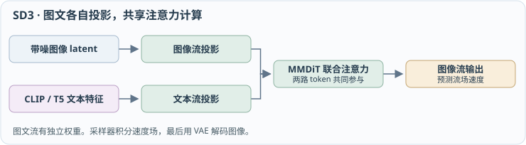
:::

**文本如何影响图像 token？** 两条流各自投影，联合注意力把文本和图像 token 放进同一次计算。

**训练**　沿真实潜变量和噪声之间的插值路径构造样本，学习把噪声送回数据分布的速度场。论文描述了图文数据过滤、caption 处理和 DPO 偏好微调。

**评测**　表 5 的深度 38、1024²、带 DPO 的模型在 **GenEval 得 0.74**，同表 512²、无 DPO 配置得 0.68。这是提示组合遵循测试，论文另用人工偏好评估排版与画质。 [论文 §3–5、表 5、附录 C](https://arxiv.org/abs/2403.03206)

### Wan2.1 与 Wan2.2 {#wan}

[阿里巴巴 Wan 团队 · 2025.02 首发、03 报告 / 2025.07]{.model-meta}

::: {.tf-architecture}
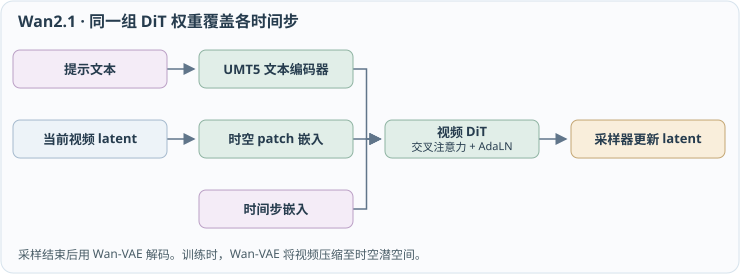
:::

::: {.tf-architecture}
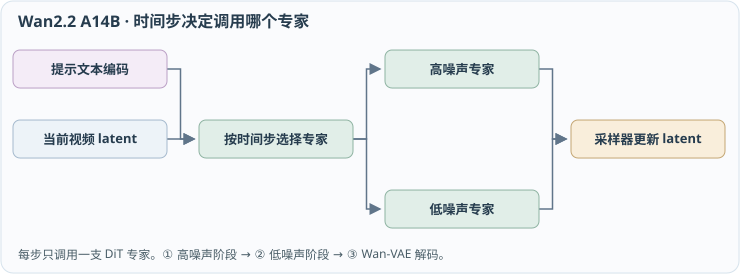
:::

**从 2.1 到 2.2，改的是哪一块？** 2.1 的同一个视频 DiT 处理各个时间步。2.2 A14B 按噪声水平选择一支专家。高噪声和低噪声阶段先后发生，两个专家共用采样过程。

**训练**　Wan2.1 报告披露了十亿量级的图像和视频素材及预训练和后训练的数据筛选流程，包括去重、画质与运动过滤，再用密集描述补充动作、镜头、场景等监督。Wan2.2 官方称其训练图像和视频数据相比 2.1 分别增长 **65.6% 与 83.2%**。该路由用于 Wan2.2 的 T2V-A14B 与 I2V-A14B。

**评测**　Wan2.1 的 14B 模型在报告表 4 得到 **86.22% VBench 综合分**，另用 Wan-Bench 和人工偏好测画质、运动及图文对齐。 [Wan2.1 报告 §3–5、表 4](https://arxiv.org/abs/2503.20314) · [Wan2.2 官方发布](https://www.alibabacloud.com/en/press-room/alibaba-releases-wan2-2-to-uplift-cinematic?_p_lc=1) · [Wan2.2 权重和推理代码](https://github.com/Wan-Video/Wan2.2)

### LTX-2 {#ltx}

[Lightricks · 2026.01 报告]{.model-meta}

::: {.tf-architecture}
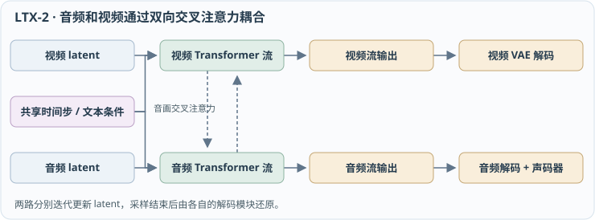
:::

**音轨在视频生成后才补上吗？** 两路 latent 在采样时通过交叉注意力交换信息，最后分别解码。

**训练**　从 LTX-Video 数据中筛出音轨信息充分的片段，给样本补充动作、镜头、对白、音乐和环境声描述。

**评测**　报告用人工偏好分别比较视觉真实感、音频保真和口型等同步性。吞吐实验单独限定 **H100、720p、121 帧、单步 Euler、CFG=1**，因此报告的秒数衡量单步开销。长片段、低资源语言和多人说话时仍会出现同步或归属错误。 [技术报告 §3–8](https://arxiv.org/abs/2601.03233) · [官方模型卡](https://huggingface.co/Lightricks/LTX-2)

## 视觉语言与全模态

```{=html}
<figure class="tf-overview">
<figcaption>视觉语言模型 · 图像信息在哪里参与计算</figcaption>
<div class="tf-route"><strong>独立编码</strong><ul><li><a href="#clip">CLIP</a><span>编码后计算图文相似度</span></li></ul></div>
<div class="tf-route"><strong>条件生成</strong><ul><li><a href="#flamingo">Flamingo</a><span>语言层交叉读取视觉记忆</span></li><li><a href="#llava">LLaVA</a><span>视觉投影接入文本序列</span></li><li><a href="#qwen3-vl">Qwen3-VL</a><span>中间视觉特征再进入多个语言层</span></li></ul></div>
</figure>
```

### CLIP {#clip}

[OpenAI · 2021.02]{.model-meta}

::: {.tf-architecture}
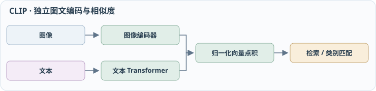
:::

用约 4 亿网络图文对训练两路编码器，使配对向量相近。推理可以缓存图像特征，再用类别描述向量做零样本分类。论文的图文对齐评测包括 ImageNet 等分类迁移任务。 [原论文](https://arxiv.org/abs/2103.00020)

### Flamingo {#flamingo}

[DeepMind · 2022.04]{.model-meta}

::: {.tf-architecture}
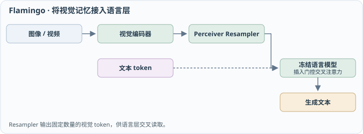
:::

将图像或视频压缩为固定数量的视觉 token，再由冻结语言模型里的新增门控交叉注意力读取。训练混合交错图文网页、图文对和视频文本对，测试时在提示中给 VQAv2、OK-VQA 或 COCO caption 示例。 [原论文](https://arxiv.org/abs/2204.14198)

### LLaVA {#llava}

[威斯康星大学麦迪逊分校、微软研究院、哥伦比亚大学 · 2023.04]{.model-meta}

::: {.tf-architecture}
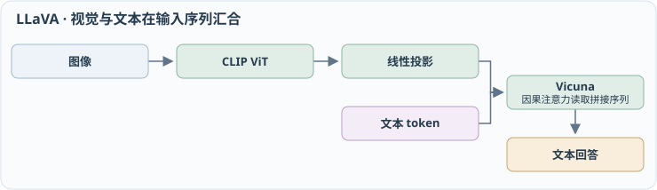
:::

用线性层把 CLIP ViT 特征投影到 Vicuna 的输入空间。先用筛选后的 CC3M 做对齐，再用 GPT-4 根据 COCO 标注生成的约 15.8 万条指令微调。论文测试视觉指令和 ScienceQA。 [原论文](https://arxiv.org/abs/2304.08485)

### Qwen3-VL {#qwen3-vl}

[阿里巴巴 Qwen 团队 · 2025.09]{.model-meta}

::: {.tf-architecture}
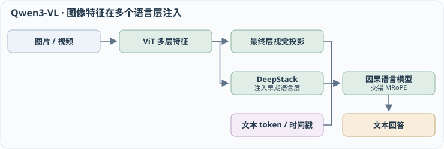
:::

延续了投影视觉 token 的路线，并通过 DeepStack 将 ViT 中间特征注入多个语言层。交错 MRoPE 处理时空位置，文本时间戳帮助模型定位视频片段。预训练覆盖图文、OCR、文档和视频，后训练含 SFT、蒸馏与强化学习。报告分别列出 DocVQA、MathVista 和 Video-MME。 [首发记录](https://github.com/QwenLM/Qwen3-VL) · [技术报告](https://arxiv.org/abs/2511.21631)

### GPT-4o 与 Gemini 2.5

[OpenAI · 2024.05]{.model-meta}  
[Google DeepMind · 2025.07 技术报告]{.model-meta}

GPT-4o 的发布页确认端到端统一处理文本、图像和音频，并列出语音识别和视觉理解评测。Gemini 2.5 披露了原生多模态稀疏 MoE Transformer，按 Pro、Flash 和推理设置报告多模态与长上下文成绩。两者均未公开足以重绘内部连接的细节。 [GPT-4o 发布与评测](https://openai.com/index/hello-gpt-4o/) · [Gemini 2.5 技术报告](https://arxiv.org/abs/2507.06261)

## 语言模型

```{=html}
<figure class="tf-overview">
<figcaption>语言模型 · 注意力可见范围与计算开销</figcaption>
<div class="tf-route"><strong>双向编码</strong><ul><li><a href="#bert">BERT</a><span>读左右上下文，预测遮盖词</span></li></ul></div>
<div class="tf-route"><strong>因果生成</strong><ul><li><a href="#gpt">GPT / GPT-3</a><span>读前缀，预测下一 token</span></li><li><a href="#llama">Llama 3.1</a><span>共享 K/V 头</span></li><li><a href="#deepseek">DeepSeek-V3 / R1</a><span>压缩 KV + 稀疏专家，R1 做推理后训练</span></li></ul></div>
</figure>
```

### GPT 与 GPT-3 {#gpt}

[OpenAI · 2018.06 / 2020.05]{.model-meta}

::: {.tf-architecture}
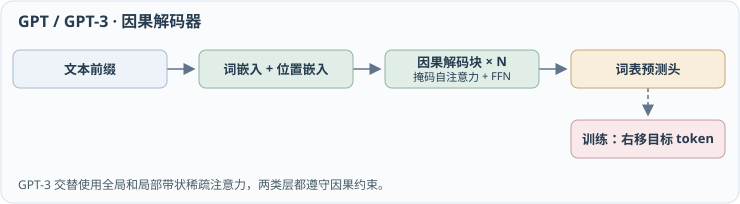
:::

**为什么训练时能并行，生成时却逐步进行？** 因果掩码允许训练一次读入完整已知序列并预测各位置的下一 token。生成时，下一次调用要读到上一步刚生成的 token。

**训练**　GPT-1 在 BooksCorpus 预训练后监督微调。GPT-3 的 175B 版从过滤后的 Common Crawl、WebText2、Books 与 Wikipedia 等采样约 300B token 训练。

**评测**　GPT-3 在提示中给零样本、单样本和少样本示例，评测过程中不更新权重。 [GPT-1 论文](https://cdn.openai.com/research-covers/language-unsupervised/language_understanding_paper.pdf) · [GPT-3 论文](https://arxiv.org/abs/2005.14165)

### BERT {#bert}

[Google AI Language · 2018.10]{.model-meta}

::: {.tf-architecture}
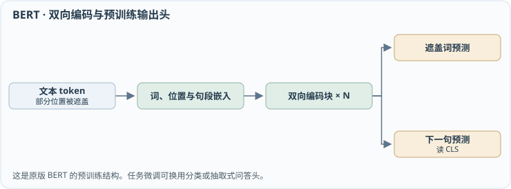
:::

双向编码器用遮盖位置两侧的上下文预测词。预训练使用 BooksCorpus 和英文 Wikipedia，目标包括遮盖语言建模与下一句预测。在 GLUE、SQuAD 等任务上微调评估。 [原论文](https://arxiv.org/abs/1810.04805)

### Llama 3.1 {#llama}

[Meta · 2024.07]{.model-meta}

::: {.tf-architecture}
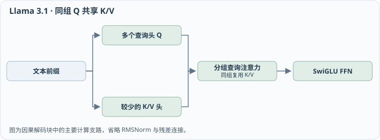
:::

405B 密集因果模型用 GQA 让多组 Q 共享较少的 K/V 头，降低 KV cache 开销。约 15.6T token 预训练后，使用监督微调、拒绝采样与 DPO。报告分别评估 MMLU、数学、代码和长上下文。 [技术报告](https://arxiv.org/abs/2407.21783)

### DeepSeek-V3 与 R1 {#deepseek}

[DeepSeek · 2024.12 / 2025.01]{.model-meta}

::: {.tf-architecture}
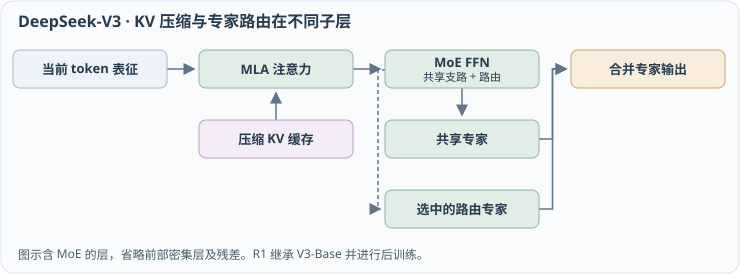
:::

V3 用 MLA 压缩注意力的 KV 表示，MoE 则在 FFN 选择专家。总参数 671B，每 token 约 37B 激活，在 14.8T token 上预训练。R1 从 V3-Base 出发，经冷启动、强化学习、拒绝采样与监督微调，在 AIME、MATH-500、GPQA 等评估。 [V3 报告](https://arxiv.org/abs/2412.19437) · [R1 报告](https://arxiv.org/abs/2501.12948)
