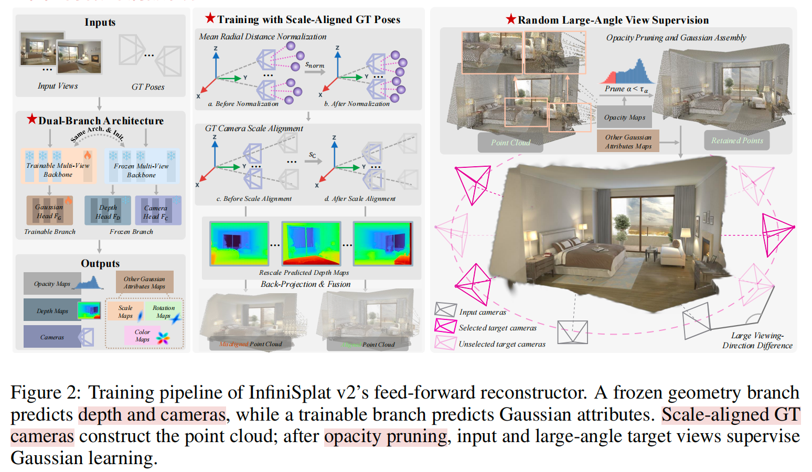
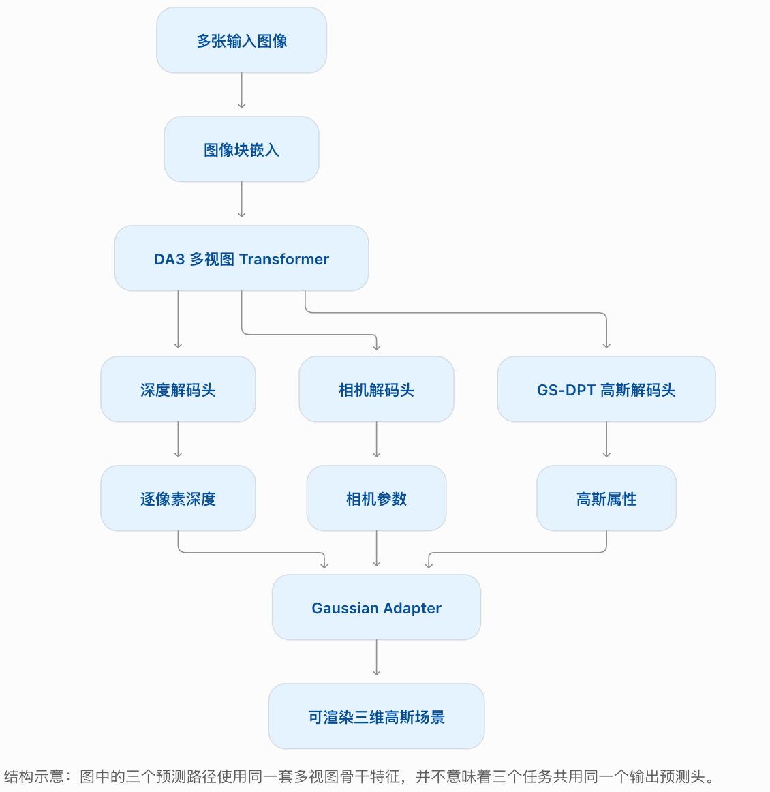
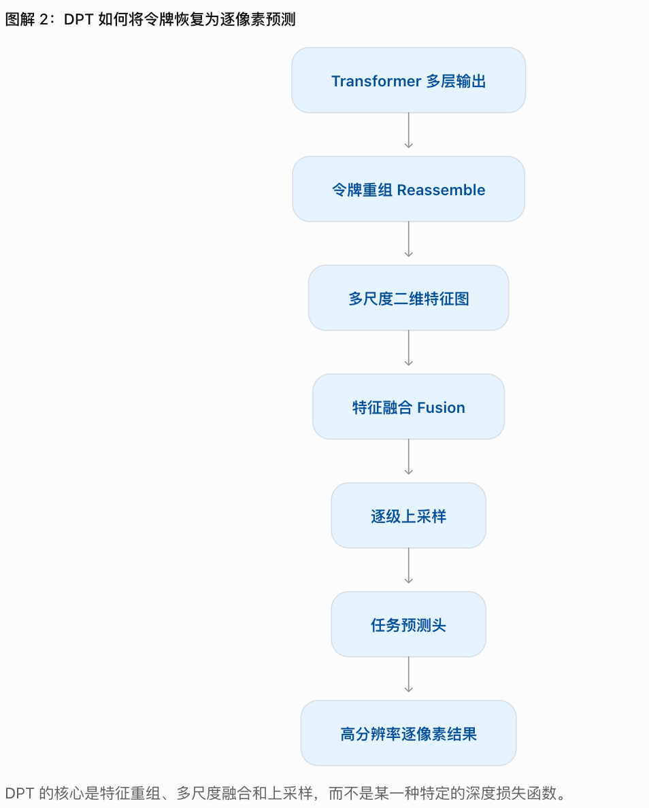
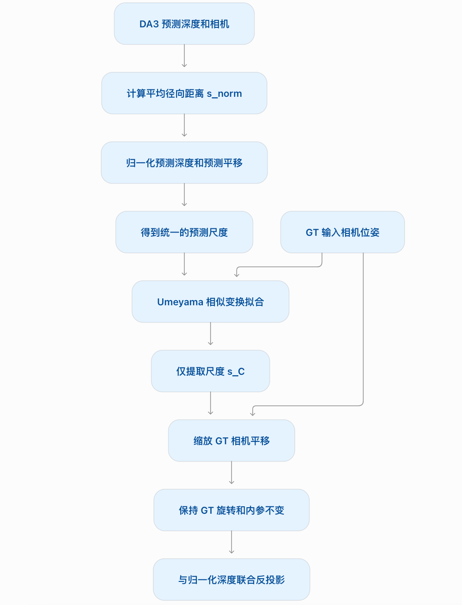

## 1. 摘要

前馈式高斯重建直接从输入图像构建用于新视角渲染的三维场景，但是，要从**预测的几何结构中学习高斯属性**，以便在**视角发生大幅变化**时实现高质量渲染，仍然具有挑战性。我们分析了高斯属性学习中的局限性，并提出 InfiniSplat v2：一种通过架构和训练方式的改变来提升渲染质量的方法。我们的方法利用一个冻结的几何分支，将几何预测与属性预测解耦；在训练时使用真实值相机位姿对齐预测的高斯；并采用大角度目标视图监督。在六个数据集上，同一个训练完成的模型所产生的前馈输出，在提供位姿和不提供位姿两种设定中，均在所评估方法中取得最先进的平均学习感知图像块相似度（LPIPS）和深度图像结构与纹理相似度（DISTS）。在提供位姿的设定下，与所评估的最强基线相比，平均 LPIPS 和 DISTS 分别下降了 25.8% 和 32.9%。进一步发现仅通过图像重建监督学习得到的不透明度（Opacity）就能够抑制几何不一致的点。

## 2. 核心insight

### V2真正研究的问题

**给你一个大致正确、但里面混有飞点和表面误差的多视图预测点云。假设不允许随便移动这些点，你是否还能通过学习每个点应该多大、朝什么方向、是什么颜色、该有多透明，把它变成高质量、能从新角度看的高斯场景？**

V2 是一种**基于强几何先验的渲染质量改进**，而不是“完全解决了三维几何错误”。

> 当几何基础模型已经提供了具有一定准确度的空间锚点时，前馈高斯重建中的主要瓶颈可能从“再预测更准确的点位置”，转移到“如何通过多视图可见性、形状约束与属性学习，控制这些不完美点对渲染的贡献”。如果只以图像重建误差训练，让几何中心自由移动反而可能破坏几何先验；固定中心并学习不透明度、尺度、旋转与颜色，能够更稳定地提升大角度新视角渲染。

这不是说“几何位置不重要”，恰好相反：它依赖一个足够强的 DA3 几何先验。作者做的是**合理分配不同变量的优化职责（Optimization Responsibility / Degrees of Freedom）**：

- 几何基础模型负责提供空间结构；
- 属性网络负责表达可见性、局部形状和外观；
- 真实值位姿对齐负责避免训练相机的误差污染属性学习；
- 大角度目标监督负责增加形状与遮挡的一致性约束；
- 学习式细化负责在固定位置的条件下进一步修正渲染属性。

## 3. 3DGS基础

点云里的普通点只有三维坐标 \((x,y,z)\)，没有真实的体积与渲染面积。三维高斯（3D Gaussian）则可以想象为放置在三维空间中的**有方向、有长短、有透明度的椭球状软斑点**。

一个高斯通常至少包含：

1. 中心（Center）\(\boldsymbol\mu\in\mathbb R^3\)：椭球放在哪里。
2. 尺度（Scale）\(\mathbf s=(s_x,s_y,s_z)\)：沿三个局部主轴有多大。
3. 旋转（Rotation）\(R\in SO(3)\) 或四元数 \(\mathbf q\)：主轴朝向如何。
4. 不透明度（Opacity）\(\alpha\in[0,1]\)：这个软斑点对穿过它的光线有多强遮挡。
5. 颜色（Color）\(\mathbf c\)：它向相机贡献什么颜色。V2 用零阶球谐函数（Zeroth-order SH），在基础表示上不显式随观察方向改变颜色。

论文的式（1）把中心单独记作 \(\boldsymbol\mu\)，其余四类属性合记为 \(\boldsymbol\xi\)。**这种符号拆分恰好对应 V2 的核心工程边界：中心不动，属性可以变。**

### 3.1 公式推导：尺度与旋转如何产生三维形状？

三维高斯密度的常见未归一化形式为

$$
G(\mathbf x)=\exp\left[-\frac12(\mathbf x-\boldsymbol\mu)^\top
\Sigma^{-1}(\mathbf x-\boldsymbol\mu)\right].
$$

这里的 \(\Sigma\) 是 \(3\times3\) 的对称正定协方差矩阵（Covariance Matrix）。如果直接学习 \(\Sigma\) 的九个元素，很难保证训练中它始终是有效的协方差。3DGS 常采用分解：

$$
S=\operatorname{diag}(s_x,s_y,s_z),\qquad
\boxed{\Sigma=RS^2R^\top=RSS^\top R^\top}.
$$

理解这两个矩阵：

- \(S^2=\operatorname{diag}(s_x^2,s_y^2,s_z^2)\) 说明椭球沿三个主轴的方差。
- \(R\) 把这个椭球从自身的局部坐标系旋转到世界坐标系。
- 假如 \(s_x=0.2,s_y=0.02,s_z=0.02\)，这个高斯是长条；假如 \(s_x=s_y=0.2,s_z=0.005\)，更像薄片，适合拟合表面。
- 如果把所有 \(s\) 放大十倍，\(\Sigma\) 变大一百倍，高斯在画面上会覆盖更广区域，更容易产生模糊。

注意：**固定 \(\boldsymbol\mu\) 不等于固定椭球表面**。即使点中心不动，只要尺度和旋转可以改变，可见表面的位置、厚度与外观仍会发生变化。因此固定中心仅限制几何自由度，不能保证所有最终渲染深度完全准确。

### 3.2 公式推导：三维高斯如何变成屏幕上的斑点？

世界坐标下的点先被相机外参变换到相机坐标，再由透视投影映射到像素：

$$
\mathbf x_c=R_{cw}(\mathbf x_w-\mathbf t_{wc}),\qquad
u=f_x\frac{X_c}{Z_c}+c_x,\quad
v=f_y\frac{Y_c}{Z_c}+c_y.
$$

其中 \(R_{cw}\) 是世界到相机旋转，\(\mathbf t_{wc}\) 是相机中心的世界坐标。为估计这个椭球投影到屏幕的形状，在高斯中心附近对透视投影做一阶线性化，得到投影雅可比矩阵（Jacobian）：

$$
J=\begin{bmatrix}
\frac{f_x}{Z_c}&0&-\frac{f_xX_c}{Z_c^2}\\
0&\frac{f_y}{Z_c}&-\frac{f_yY_c}{Z_c^2}
\end{bmatrix}.
$$

于是二维屏幕协方差近似为

$$
\boxed{\Sigma_{2D}\approx J R_{cw}\,\Sigma_{3D}\,R_{cw}^{\top}J^{\top}}.
$$

推导背后的核心是随机变量线性变换公式：若 \(\mathbf y=A\mathbf x\)，则 \(\operatorname{Cov}(\mathbf y)=A\operatorname{Cov}(\mathbf x)A^\top\)。透视投影并非线性函数，但在足够小的高斯附近可用雅可比近似。真实渲染器还会加入抗混叠或最小屏幕方差等处理；论文使用 `gsplat` 与 `eps2d=10^{-2}`。

这直接解释 V2 为什么强调大角度目标视图：改变相机朝向和高斯相对观察方向，相当于改变 \(J R_{cw}\)，同一个三维高斯从不同方向投影出的椭圆会不一样，从而为 \(\Sigma_{3D}\) 提供更多约束。

### 3.3 公式推导：不透明度如何控制一个点“出现”还是“消失”？

对于一条像素射线，假设与屏幕高斯的贡献按深度从前到后排列。设第 \(k\) 个高斯在这个像素位置的有效不透明度为 \(a_k\)。前 \(k-1\) 个高斯留下的透射率为

$$
T_k=\prod_{j<k}(1-a_j),\qquad
w_k=T_ka_k.
$$

最终颜色近似为

$$
\boxed{\hat C=\sum_k w_k\mathbf c_k+T_{\mathrm{end}}\mathbf c_{\mathrm{bg}}}.
$$

举例：假设同一条射线上有两个高斯，前景的有效 \(a_1=0.8\)，后景的有效 \(a_2=0.5\)。那么 \(w_1=0.8\)，\(w_2=(1-0.8)\times0.5=0.1\)。如果前景是错误飞点，它可能严重遮挡正确表面；如果网络把它的 \(a_1\) 学到 0.01，那么它几乎不再干扰后景。这就是**通过改变不透明度而非移动点来“处理飞点”**的物理—渲染直觉。

需要注意：这个结论只针对该点在指定像素上的渲染贡献。低不透明度并不意味着预测的三维点位置被修正，更不等于三维表面的真实几何被恢复。

## 4. 方法

### 4.1 前馈重建部分（Stage I）

按真实的执行关系，步骤是：

1. 输入 \(N\) 张 RGB 图像，有时还提供相机内参与外参。
2. 冻结 DA3 分支 \(\Phi_{\mathrm{geo}}\) 输出各张图的深度 \(\hat D_i\) 和相机 \(\hat\Pi_i\)。
3. 相同预训练初始化、参数独立的属性分支 \(\Phi_{\mathrm{attr}}\) 输出多层视觉特征，再由 DPT 解码器产生每个像素的 \(\alpha,\mathbf s,\mathbf q,\mathbf c\)。
4. 在训练时，根据输入相机对应关系估计尺度 \(s_C\)，用尺度对齐的真实值相机反投影**预测深度**，得到高斯中心；在测试时则按是否提供位姿选择对应的相机构建方案。
5. 对三维空间中冗余的点按体素合并；对不透明度小于 0.01 的高斯进行剪枝。
6. 使用输入视图与采样目标视图的渲染损失训练属性分支，只更新允许训练的参数。

“前馈输出（Ours）”到这里就结束。它不是在测试时对当前场景进行几千次梯度下降。

### 4.2 学习式细化部分（Stage II）

从上面的初始场景 \(\mathcal G^0\) 出发：

1. 渲染到输入相机，计算重建损失关于当前高斯属性的梯度。
2. 把这些梯度当作**特征向量**，和图像特征、当前属性、KNN 邻居特征、隐藏状态一起输入细化网络。
3. 细化网络输出各个高斯属性的有限幅度增量。
4. 高斯中心保持不变，重新渲染，再用新梯度更新下一步；测试时总共执行三步。

这和传统 Adam 的本质区别在于：Adam 使用预先定义的动量和方差自适应规则处理梯度；学习式细化器利用训练得到的网络参数与局部三维上下文，尝试从“哪里错了”预测“怎样修改属性更有效”。但两者都不改变点中心。

---

### 补充：

#### DA3-GS 的共享特征与多任务解码

在这个过程中，Transformer 某一层的输出可以写成：

$$
F^l=\operatorname{Transformer}^l(I_1,\ldots,I_N)
$$

更具体地说，给第 $i$ 张图的第 $j$ 个图像块输出特征：

$$
f_{i,j}^{(l)}\in\mathbb R^d
$$

因为经历了跨视图信息交换，这个特征可能依赖其他图像：

$$
f_{i,j}^{(l)}
=
f(I_1,\ldots,I_N;i,j)
$$

**所谓共享的多视图特征（Shared Multi-view Features），就是深度、相机和高斯预测都能够利用这套已经进行跨视图信息交互的视觉表示。**

DA3 论文及公开实现均支持这种结构描述。

##### 这种特征与普通 DINO 特征有什么区别？

普通单图 DINO 特征擅长捕获：

- 语义信息（Semantic Information）：这个区域属于桌子、地面还是墙面。
- 纹理信息（Texture Information）：局部是什么视觉模式。
- 一定程度的空间结构（Spatial Structure）。

多视图 DA3 特征还通过跨图交互学习：

- 不同图像中哪些区域可能对应同一个三维结构。
- 同一表面在不同视角下如何变化。
- 相机运动与场景深度之间的联系。

但是需要注意：这不意味着 DA3 一定显式构造了像经典 SfM 一样的匹配轨迹（Feature Tracks），也不意味着每个注意力权重都等价于可靠的像素对应关系。

它是在神经网络特征空间里学习几何关联。

#### DPT（Dense Prediction Transformer）

**把 Transformer 输出的低分辨率、具有丰富上下文信息的图像块特征，变成每个像素都有预测值的高分辨率输出。**

假设输入图片为 $448\times448$。如果图像块大小为 $14\times14$，Transformer 可能得到一个 $32\times32$ 的特征网格。但我们需要的是：

$$
D\in\mathbb R^{448\times448}
$$

即每个像素都有深度。如果预测高斯属性，输出还需要包含：

$$
A\in\mathbb R^{448\times448\times C_{\mathrm{GS}}}
$$

其中 $C_{\mathrm{GS}}$ 是高斯属性的通道数量，取决于颜色表示及参数化方式。

Transformer 的输出分辨率较低，无法直接得到这个高分辨率结果。DPT 就承担了这一转换工作。

DPT 的核心是特征重组、多尺度融合和上采样，而不是某一种特定的深度损失函数。DPT 原始工作通过将不同 Transformer 层的令牌重组成多尺度特征图，再用卷积特征融合模块逐步恢复空间分辨率，最终执行深度估计或语义分割等稠密预测任务。

---

## 5. 双分支为什么能够阻止几何退化？——式（2）

### 5.1 先理解梯度“泄漏”到几何分支的问题

如果一个网络同时预测点坐标 \(\boldsymbol\mu_\theta\) 和颜色、形状等属性 \(\boldsymbol\xi_\theta\)，并只使用图像损失训练，那么梯度为

$$
\frac{\mathrm dL}{\mathrm d\theta}=
\underbrace{\frac{\partial L}{\partial\boldsymbol\mu}
\frac{\partial\boldsymbol\mu}{\partial\theta}}_{\text{位置变化的梯度路径}}
+\underbrace{\frac{\partial L}{\partial\boldsymbol\xi}
\frac{\partial\boldsymbol\xi}{\partial\theta}}_{\text{属性变化的梯度路径}}.
$$

举一个典型的歧义：某个预测点位置略有偏差，导致渲染的纹理边缘偏移。为了减小像素误差，网络可以：

- 正确地学习高斯的尺度、旋转和颜色分布；
- 直接把点中心向产生正确像素的位置挪动。

第二条路径可能更容易快速降低当前训练视图的损失，但如果这个“挪点”只对有限角度有效，换到大基线视角就可能出现扭曲、浮动表面、深度失真。**图像渲染误差小，并不能唯一保证三维坐标准确**。

V2 通过冻结几何分支并禁止中心偏移，强制令 \(\partial\boldsymbol\mu/\partial\theta_{\mathrm{attr}}=0\)，让像素损失主要通过 \(\boldsymbol\xi\) 被解释。

### 5.2 为什么不是只冻结整个 DA3，然后训练一个小高斯头？

V2 对属性分支的最后十个 Transformer 模块进行微调，而非只训练高斯头。原因是**原来用于深度、相机的表示不一定包含最适于渲染的颜色边缘、透明度与椭球形状线索**。允许属性分支微调高层特征，既能改变对渲染有用的视觉特征，又不会影响冻结分支的深度估计。

注意这不是“两套模型完全独立训练”：两者使用同一 DA3 预训练参数初始化，但微调后不同分支的参数独立。训练成本也不等同于只加一个很小的预测头。实验表 2 的 `w/o A` 说明属性骨干微调有帮助，但 ETH3D 上 LPIPS 仅改善约 1.1%，DTU 上改善约 20.8%，存在明显场景依赖。

### 5.3 区分三种“冻结”

| 对象                                    | V2 如何处理                                                  | 为什么重要                         |
| --------------------------------------- | ------------------------------------------------------------ | ---------------------------------- |
| 几何分支权重 \(\theta_{\mathrm{geo}}\)  | 训练时始终冻结                                               | 防止几何估计被渲染损失改坏         |
| 高斯中心 \(\boldsymbol\mu\)             | 细化前后都固定；无学习式偏移                                 | 阻断通过位置补偿属性误差           |
| 属性分支权重 \(\theta_{\mathrm{attr}}\) | 第一阶段仅微调最后十个 Transformer 模块和高斯头；第二阶段冻结 | 允许学习用于渲染的特征和高斯属性   |
| 高斯属性 \(\boldsymbol\xi\)             | 前馈预测，第二阶段可以进一步更新                             | 调节可见性、形状和颜色             |
| 第二阶段细化器权重                      | 训练时更新，测试时不变                                       | 测试时更新的是场景属性而非网络模型 |

## 6. 最重要的几何推导：为什么要做尺度归一化和 Umeyama 对齐？——式（3）（4）（9）

### 6.1 相机反投影的初等推导

针孔相机（Pinhole Camera）满足

$$
\lambda\begin{bmatrix}u\\v\\1\end{bmatrix}
=K\begin{bmatrix}X_c\\Y_c\\Z_c\end{bmatrix},
\quad
K=\begin{bmatrix}f_x&0&c_x\\0&f_y&c_y\\0&0&1\end{bmatrix}.
$$

假设模型预测的是相机 \(z\) 轴深度 \(D(u,v)=Z_c\)，那么

$$
\mathbf x_c=D(u,v)K^{-1}\mathbf u.
$$

再通过相机到世界坐标变换（Camera-to-world Transform）

$$
\mathbf x_w=R_{wc}\mathbf x_c+\mathbf t_{wc}
=D(u,v)R_{wc}K^{-1}\mathbf u+\mathbf t_{wc},
$$

就得到论文式（4）。其中 \(\mathbf t_{wc}\) 正是相机中心在世界坐标系中的位置。若你把世界到相机的平移直接代入，则会算错：**相机坐标约定必须前后一致**。

### 6.2 为什么预测深度没有天然的米制尺度？

一般的多视图几何重建存在尺度规范自由度（Scale Gauge Freedom）。如果将所有三维点与所有相机平移乘上 \(\lambda>0\)，相机内参和旋转不变，投影像素依然相同：

$$
\pi\big(R(\lambda\mathbf x-\lambda\mathbf t)\big)
=\pi\big(\lambda R(\mathbf x-\mathbf t)\big)
=\pi\big(R(\mathbf x-\mathbf t)\big),
$$

因为透视投影中 \(\pi(\lambda X,\lambda Y,\lambda Z)=(f_xX/Z+c_x, f_yY/Z+c_y)\)，尺度 \(\lambda\) 抵消了。

因此，需要把“模型预测的几何单位”和“真实值相机使用的单位”统一起来。但注意：**统一尺度不等于保证真实世界米制尺度**，它只是在训练时让两种数据落到兼容的坐标单位里。

### 6.3 式（3）：平均径向距离归一化在做什么？

假设所有候选三维点的世界坐标是 \(\mathbf x_j\)，定义

$$
s_{\mathrm{norm}}=\frac1{N_p}\sum_{j=1}^{N_p}\|\mathbf x_j\|_2.
$$

再把点、深度与预测相机平移整体除以这个量，归一化点云的平均径向距离便约为 1。

**数值例子**：如果预测点云距参考原点的平均距离是 20 个任意单位，某像素深度预测为 10，那么新深度是 0.5；相机平移 \((4,0,0)\) 被变成 \((0.2,0,0)\)。这保留了 10:4 的相对尺度关系，只改变世界的单位。

为什么这个步骤不能只归一化深度？因为这样会错误地改变相机与点之间的相对位置，产生跨视图不一致。**深度与平移必须成对缩放。**

### 6.4 Umeyama 方法的本质是什么？

已知两组对应的相机中心，真实值轨迹 \(\{\mathbf c_i^\star\}\) 与归一化预测轨迹 \(\{\bar{\mathbf c}_i\}\)，Umeyama 方法试图求解

$$
\min_{s>0,Q\in SO(3),\mathbf b}
\sum_i\|\bar{\mathbf c}_i-(sQ\mathbf c_i^\star+\mathbf b)\|^2.
$$

如果不考虑估计旋转的细节，在给定 \(Q\) 后，将两组坐标分别去中心化，最优尺度满足

$$
s=\frac{\sum_i(\bar{\mathbf c}_i-\bar{\mathbf c})^\top
Q(\mathbf c_i^\star-\mathbf c^\star)}
{\sum_i\|\mathbf c_i^\star-\mathbf c^\star\|^2}.
$$

完整 Umeyama 则通过中心化点协方差的奇异值分解（Singular Value Decomposition，SVD），联合求解正交旋转与尺度。**V2 只保留求出的尺度 \(s_C\)**，不使用求出的旋转与平移去改变真实值相机，因为两组相机已经分别相对于对应的同一输入参考视图表达。这样可以继续保留真实值相机间可靠的相对朝向。

**第二个数值例子**：如果归一化预测相机中心之间的基线长度约为 0.5，而对应真实值相机基线是 2 米，那么 \(s_C\) 可能约为 \(0.5/2=0.25\) 个归一化单位／米。真实值相机相对于参考相机的平移为 1 米，就缩放为 0.25 个归一化单位。然后用这个位置和归一化预测深度反投影，二者才处于可比较的尺度。

### 6.5 为什么训练时用真实值位姿很重要？

假设预测相机的方向存在 2° 偏差，离相机 5 米的深度点，单纯由角度误差造成的横向位置偏差量级约为

$$
\Delta x\approx D\tan(2^\circ)\approx 5\times0.0349=0.1745\ \mathrm m.
$$

这个例子说明：很小的相机角度误差，到了远距离也会产生可见的反投影位置误差。如果在构建点云时使用预测相机、在渲染监督时使用真实值目标相机，网络可能被迫通过放大高斯、扭转高斯、调整颜色来吸收相机不匹配。如此得到的属性不一定能迁移到新视角。

使用真实值输入相机反投影与真实值目标相机监督，就消除了这种训练时不一致的来源之一，但**并没有消除预测深度本身的误差**。这是 V2 方法设计中非常重要的界限。

### 6.6 对尺度可观测性的一个隐藏限制

式（3）统计的是所有点到参考原点的距离，它本身不保证抵抗飞点离群值；Umeyama 使用输入相机中心，若拍摄轨迹几乎不移动、相机中心极为集中、轨迹退化或预测轨迹有明显畸变，估计的尺度会不稳定。尤其是纯旋转（Pure Rotation）或极低视差（Low Parallax）场景，输入相机中心基线几乎为零，尺度估计的分母会非常小。

论文没有在主结果中给出按视差、相机轨迹条件数（Condition Number）或位姿误差区间分组的系统性评估，所以不能凭这里的对齐步骤断言所有退化视角都能稳定处理。

## 7. 大角度监督为什么是关键？——式（5）、式（8）

### 7.1 从二维图像恢复三维椭球的欠约束性

假设正对一个很薄的高斯椭球拍照。在这一视角下，沿观察射线方向的厚度变化可能几乎不影响它在屏幕上的二维投影；你很难单靠这张图判断这个椭球是薄片还是很深的柱体。这就是视角相关的形状歧义（View-dependent Shape Ambiguity）。

当目标相机从更侧面的方向观察，高斯的长轴／短轴可能投影成截然不同的二维形状，于是网络不得不学习一个能够同时解释多个角度的形状，而不能只把训练相机上的图像涂得好看。

**但要区分**：大角度监督在数学上改善某些形状参数的可辨识性（Identifiability），并不自动恢复所有未观测表面。若目标区域被输入视图遮挡，根本没有对应的真实信息，单纯增加损失角度无法创造真实细节。

### 7.2 式（5）为什么是“与最近输入相机的角度”？

设候选相机光轴 \(\mathbf f_v\) 与第 \(i\) 个输入相机光轴 \(\mathbf f_i\) 都是单位向量。单位向量内积为夹角余弦：

$$
\mathbf f_v^\top\mathbf f_i=\cos\theta_{v,i},
\qquad \theta_{v,i}=\arccos(\mathbf f_v^\top\mathbf f_i).
$$

当输入图像有很多张时，若候选目标仅与某一张输入相机的朝向非常接近，就已经属于一个“观察方向不够新”的视角。于是作者取所有角度的最小值 \(\min_i\theta_{v,i}\)，让这一分数衡量候选目标距离**最近的输入观察方向**有多远。

假设输入相机朝向为 0°、10°、25°：

- 候选 A 朝向 28°，与最近输入角度差 3°，得分 3°；
- 候选 B 朝向 50°，最近角度差 25°，得分 25°；
- 候选 C 朝向 12°，最近角度差 2°，得分 2°。

按照此定义，B 最偏向大角度监督。附录揭示的**实际采样不是永远取最大值**：候选先按此得分分为上下两半，然后以 70% 的概率选择大角度池、30% 选择小角度池，并在池内不放回随机抽取四个目标视图。

### 7.3 论文的“Large-angle”究竟有多大？

图 8 的均值显示，局部插值采样的最近光轴夹角为 12.34°，作者采样为 17.97°，均值差约为 **5.63°**，约 **45.6%** 的相对增加。这是比局部插值更偏向大角度的采样，但不能把其均值夸大成 90°、120° 那样的极端视角。

注意：**光轴角度（Optical-axis Angle）不等于相机视点基线（Camera Baseline），也不等于场景中每个三维点的真实视差角（Triangulation Angle）。** 两个相机即使朝向平行，只要相距很远，也可能有很大视差；反之，两台相机在同一位置纯旋转，光轴夹角虽大，却无法产生多视图三角测量的有效平移基线。因此，如果研究目标强调几何可测量性，应进一步考虑按点计算视差角、可见性与不确定性，而不能仅依赖光轴夹角。

### 7.4 式（8）为什么需要 GT 深度掩码？

作者在目标视图某像素上读取 GT 深度，将它反投影为三维点，再投影到输入视图。如果输入图像上的深度与投影点的预测深度符合

$$
|z_{\mathrm{proj}}-d_{\mathrm{src}}|
\le\max(0.03,0.01d_{\mathrm{src}}),
$$

该目标像素就有来自输入观测的深度一致支持；否则，不把它纳入损失。可以把它理解为一个简单的跨视图可见性与遮挡一致性检查（Visibility / Occlusion Consistency Check）。

例如采样的输入视图深度是 2 米，则相对阈值为 0.02，绝对阈值 0.03 更大，容许误差 0.03。若深度为 20 米，相对项 0.2 更大，容许误差变为 0.2。

**为什么重要**：目标相机可能看到输入图像中从未出现过的背面与遮挡区域。如果作者直接用这些像素对前馈预测做强监督，任务会包含难以由输入确定的内容。用掩码可以更集中地学习“已观测内容在新视角下应如何渲染”。这也意味着论文的主要实验结论应理解为**在其定义的有效区域上的新视角渲染性能**，不能直接外推为完整新暴露区域的生成质量。

## 8. 体素合并、不透明度剪枝与离群点可靠性

### 8.1 为什么同一表面会产生很多重复高斯？

输入有 \(N\) 张图，每张图尺寸约为 \(H\times W\)。逐像素反投影的候选点数量量级是 \(NHW\)。同一张桌面可能同时出现在八张图中，那么不同视图对它的预测会堆积很多位置接近的点；这些冗余点如果全部保留，渲染内存、光栅化速度和不透明度排序都会受到影响。

作者借鉴 AnySplat 和 WorldMirror 2.0 的体素合并（Voxel Merging），在尺度归一化坐标里按照边长 0.004 的立方体划分空间，将某个体素内的冗余点合并。细化器还利用同一合并分组聚合 DPT 特征。

### 8.2 为什么 \(\alpha<0.01\) 能选择性去除飞点？

假设一个飞点在某个输入视角看起来颜色接近背景，但换到其他输入或监督视角就出现在不应存在的位置。只要渲染损失足够覆盖这些观察，增大其不透明度可能产生更多错误像素，而降低不透明度能够减少损失。因此，高斯预测头有动力学会“把可疑点变透明”。

论文使用独立于不透明度的几何标签进行验证：

- **几何不一致（Inconsistent）**：在至少两个 GT 观察中进入真实自由空间，且与任何观察到的表面深度都不一致。
- **表面一致（Surface-consistent）**：与至少两个观察的表面深度一致，且不违反自由空间。
- **不确定（Uncertain）**：既不满足前两种条件之一。

阈值 0.01 时，论文报告去掉 51.8% 的几何不一致点，而只删除 7.5% 的全部点；保留 93.3% 的表面一致点。**这属于“选择性相关性证据”，而不是不透明度已经被证明为严格校准的几何置信概率。** 研究更进一步可以画出可靠性曲线、精确率—召回率曲线（Precision–Recall Curve）、分场景阈值鲁棒性以及与多视图深度误差的统计关系。

### 8.3 一项可复算的量：相对富集程度

若随机删除全部点的 7.5%，理论上几何不一致点也预计只删除约 7.5%。V2 在同一阈值下删除了 51.8% 的不一致点，这个召回率与全局删除率的比值约为 \(51.8/7.5\approx6.91\)。这表明被删除集合对几何不一致点存在较强富集（Enrichment）；但并不能直接得出删除集合的**精确率**，因为还需要知道全部点中不一致点的初始占比。

## 9. 第一阶段到底怎样训练？——式（10）—（12）

### 9.1 L1 重建误差

单像素 RGB 平均绝对误差为

$$
e_v(p)=\frac13\sum_{c\in\{R,G,B\}}|\hat I_v(p,c)-I_v(p,c)|.
$$

它直接鼓励渲染颜色接近 GT。然而，L1 对整体图像感知结构未必敏感，可能偏向得到略显平滑、但像素平均误差较低的结果。

### 9.2 LPIPS 感知误差

学习感知图像块相似度（Learned Perceptual Image Patch Similarity，LPIPS）将图像输入预训练视觉特征网络（本文采用 VGG 特征），在特征层比较生成图与真实图的局部差异。其基本思想是：人眼对“结构边缘是否正确”的敏感度，可能高于单个 RGB 像素的差值。

论文用空间 LPIPS（Spatial LPIPS）产生逐位置的距离图，之后与 L1 的误差图等权相加，并用有效像素的总数归一化。若设 \(M_v(p)\in\{0,1\}\)，则式（12）可重写为

$$
\mathcal L_{\mathrm I}=\frac{
\sum_{v,p}M_v(p)e_v(p)+\sum_{v,p}M_v(p)d_v(p)}
{\max(1,\sum_{v,p}M_v(p))}.
$$

其中 \(\max(1,\cdot)\) 避免所有掩码均无效时出现除零。**两个损失项“权重相等”是作者明确写出的训练设置**；不要把第二阶段的 0.8/0.2/0.5 误读成第一阶段的权重。

## 10. 第二阶段：为什么还要学一个 KNN Transformer 细化器？

### 10.1 直接 Adam 为什么未必高效？

传统逐场景优化把当前所有高斯属性当作变量，反复计算输入图像损失梯度，再按 Adam 的统一更新规则调整。它能在训练相机上降低损失，却不能天然利用跨场景预训练得到的“物理形状与纹理该怎样变化”的经验。

学习式细化器把梯度本身作为观测特征，再通过 KNN 局部图传播信息。这有两个潜在好处：

1. 同一个物体表面的相邻高斯通常应具有相似几何属性，空间邻居能提供局部一致性线索。
2. 网络能够跨场景学习更有针对性的修改方向，不必完全依赖固定梯度下降规则。

但这是**合理的机制解释，不是已经被作者单独证明的因果结论**。文中只展示与三步 Adam 的比较，并没有完全等算力、等墙钟时间（Wall-clock Time）的广泛优化器对照。

### 10.2 KNN Transformer 的信息是怎样组合的？

每个高斯有自己的局部状态：

- 来自图像的八通道 DPT 投影特征；
- 当前高斯的尺度、不透明度、旋转与颜色；
- 当前属性对应的渲染梯度；
- 邻居距离和邻居特征；
- 由前一步保留下来的 16 维隐藏状态。

这些信息拼接投影到 64 维，经过四层 Transformer；每层对八个最近邻做单头注意力。令 \(q_i,k_j,v_j\) 分别是点 \(i\) 的查询、邻居 \(j\) 的键和值，那么典型注意力形式为

$$
\operatorname{Attn}_i=
\sum_{j\in\mathcal N(i)}
\underbrace{\frac{\exp(q_i^\top k_j/\sqrt d)}
{\sum_{\ell\in\mathcal N(i)}\exp(q_i^\top k_\ell/\sqrt d)}}_{\text{注意力权重}}
v_j.
$$

这是通用的 KNN 注意力原理示意，**并非论文提供的逐行代码实现**。它说明为什么一个点可以借助邻居来决定自己的属性更新。固定中心使邻居图跨细化步骤不变，从而减少重复邻域搜索开销。

### 10.3 为什么更新尺度要用指数，更新不透明度要用 Logit？

因为参数有不同的定义域：尺度 \(s>0\)，不透明度 \(0<\alpha<1\)，颜色通常也有数值范围，而旋转需要遵守旋转群约束。

- **尺度**：\(s_{\mathrm{new}}=s_{\mathrm{old}}\exp(\Delta\log s)\)。指数恒正，因此不可能产生负尺度；\(\Delta\log s\) 表示相对比例调整而非绝对加减。
- **不透明度**：\(\operatorname{logit}(\alpha)=\log[\alpha/(1-\alpha)]\)，在无界实数域更新后用 Sigmoid 变回 \((0,1)\)。
- **颜色**：在 RGB Logit 空间更新，再变回 RGB 与零阶 SH 系数。
- **旋转**：论文使用局部旋转向量增量，允许学习小幅旋转调整。若使用李群视角，可以将局部旋转增量想象成在 \(SO(3)\) 附近的切空间（Tangent Space）操作，但论文没有展开完整指数映射推导。

### 10.4 为什么增加限制 \(a\tanh(\mathrm{raw})\)？

双曲正切函数满足 \(\tanh(x)\in(-1,1)\)。乘上系数 \(a\)，可以限制每步在不透明度 Logit、旋转和 RGB Logit 中的更新幅度：分别最多接近 0.1、0.25、1.0。隐藏状态增量则限制在 \((-0.1,0.1)\)。

限制不是说最终属性变化一定小于这些数：多步更新会累计；尺度的对数更新甚至没有残差裁剪，所以仍可能变化很大。作者用分参数空间约束，目的是避免某一类更新太激进。

## 11. 一阶代理损失如何实现“能训练，却不求二阶导”？——式（17）（18）

细化网络输入的一个重要特征是当前高斯属性的渲染梯度

$$
\mathbf g=\frac{\partial L_{\mathrm{render}}}{\partial\mathbf x}.
$$

如果训练细化网络时保留从 \(\mathbf g\) 回到 \(\mathbf x\) 的计算图，进一步求 \(\partial\mathbf g/\partial\mathbf x\) 就涉及海森矩阵（Hessian），即二阶导数（Second-order Derivatives）。对数百万高斯与复杂光栅化过程来说，这会造成显著的时间和显存成本。

### 11.1 停止梯度（Stop-gradient）是什么？

\(\operatorname{sg}(x)\) 在前向计算时返回与 \(x\) 相同的数值，但在反向传播时视作常数。用 PyTorch 类比，就是 `x.detach()`，而不是 `x.clone()`。

于是可以先构造一个与网络更新结果数值相同的独立叶张量 \(\mathbf z=\operatorname{sg}(\mathbf x)\)，在它上面计算渲染损失的梯度 \(\mathbf r=\operatorname{sg}(\nabla_{\mathbf z}L(\mathbf z))\)。接着把这个梯度当作固定系数参与外层训练，而不让它本身的求导图继续传播。

### 11.2 代理损失的严谨推导

定义

$$
L_{\mathrm{proxy}}(\mathbf x)=
\underbrace{\operatorname{sg}(L(\mathbf z))}_{\text{固定的损失标量}}
+\underbrace{\big\langle\mathbf x-\operatorname{sg}(\mathbf x),\mathbf r\big\rangle}_{\text{前向为零，反向含梯度}}.
$$

**前向值**：由于 \(\operatorname{sg}(\mathbf x)\) 与 \(\mathbf x\) 的数值完全一致，\(\mathbf x-\operatorname{sg}(\mathbf x)=0\)，所以

$$
L_{\mathrm{proxy}}(\mathbf x)=L(\mathbf z)
\quad\text{（数值相等）}.
$$

**对 \(\mathbf x\) 求导**：第一项停止梯度，导数为 0；第二项因为 \(\mathbf r\) 已分离，所以

$$
\frac{\partial L_{\mathrm{proxy}}}{\partial\mathbf x}=\mathbf r.
$$

如果 \(\mathbf x=f_{\boldsymbol\theta}(\cdot)\) 是细化网络的输出，那么由链式法则（Chain Rule）

$$
\boxed{\nabla_{\boldsymbol\theta}L_{\mathrm{proxy}}=
\left(\frac{\partial\mathbf x}{\partial\boldsymbol\theta}\right)^\top
\mathbf r}.
$$

这就是式（18）。其物理含义是：**让细化网络沿渲染损失的一阶下降方向学习，但不反传产生这个梯度本身所涉及的二阶导数**。训练第 \(k\) 步时，外层损失仍按 \(0.9^{K_r-k}\) 加权。

## 12. 实验

### 12.1 训练和评估有两个不相同的 \(N\) 范围

训练：随机抽取 **4—12** 张输入图，目标图固定四张；测试：**4、8、16** 张输入图，目标图仍是四张。这意味着作者包含了训练视图数范围之外的 16 视图评估。模型能够接收更多图像，并不自动证明无限扩展；原论文在 KITTI 上使用滑动窗口处理千帧序列，不等于所有千帧一次进入网络。

### 12.2 训练数据、计算资源、时间

| 项目               | 论文原始设置                                  |
| ------------------ | --------------------------------------------- |
| 数据混合           | Hypersim 60%，Raw3D 10%，ScanNet++ 30%        |
| Stage I 训练参数   | 属性分支最后 10 个 Transformer 模块 + 高斯头  |
| Stage I 步数       | 25,000 步，约 48 小时                         |
| Stage I 峰值学习率 | 骨干 \(10^{-6}\)，高斯头 \(2\times10^{-4}\)   |
| Stage II 训练参数  | DPT 特征投影 + KNN Transformer 细化器         |
| Stage II 步数      | 5,000 步，约 13 小时                          |
| 总硬件             | 16 × H20 GPU；全局批大小 16                   |
| 优化器             | AdamW，\(\beta=(0.9,0.95)\)，全局梯度裁剪 1.0 |
| 测试三步细化       | 固定网络权重，更新尺度、不透明度、旋转、颜色  |
| 高斯中心           | 固定；合并后剪枝阈值 0.01                     |

只把两阶段的墙钟时间相加约为 **61 小时**，是作者给出的训练耗时之和，不包含 DA3 预训练、数据预处理、推理部署、全部基线评估与实验反复试错的成本。

### 12.3 感知质量、像素质量与几何质量区别

| 评价对象         | 常用指标                                             | 能证明什么                                   | 不能证明什么                 |
| ---------------- | ---------------------------------------------------- | -------------------------------------------- | ---------------------------- |
| 渲染的逐像素误差 | PSNR、SSIM                                           | 图像与真实视图在像素和局部结构层面的接近程度 | 绝对三维距离正确             |
| 学习感知质量     | LPIPS                                                | 深层图像特征意义上的感知相似性               | 点云没有漂移、几何是真实表面 |
| 结构与纹理感知   | DISTS                                                | 感知结构与纹理的一致性                       | 米制尺度准确、法向量正确     |
| 三维几何         | 深度 MAE/RMSE、点到面距离、Chamfer Distance、F-score | 几何位置／表面是否接近参考                   | 渲染必然感知更好             |
| 真实尺度         | 尺度误差、绝对轨迹误差、测距偏差、长度相对误差       | 是否具有可测量性（Metric Accuracy）          | 纹理是否逼真                 |

