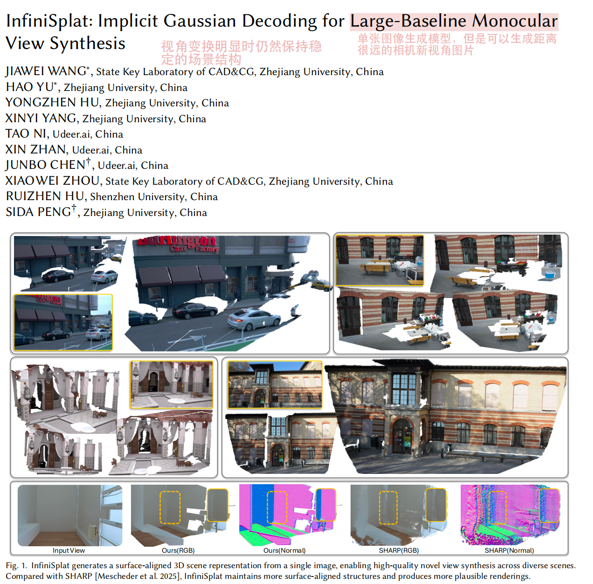
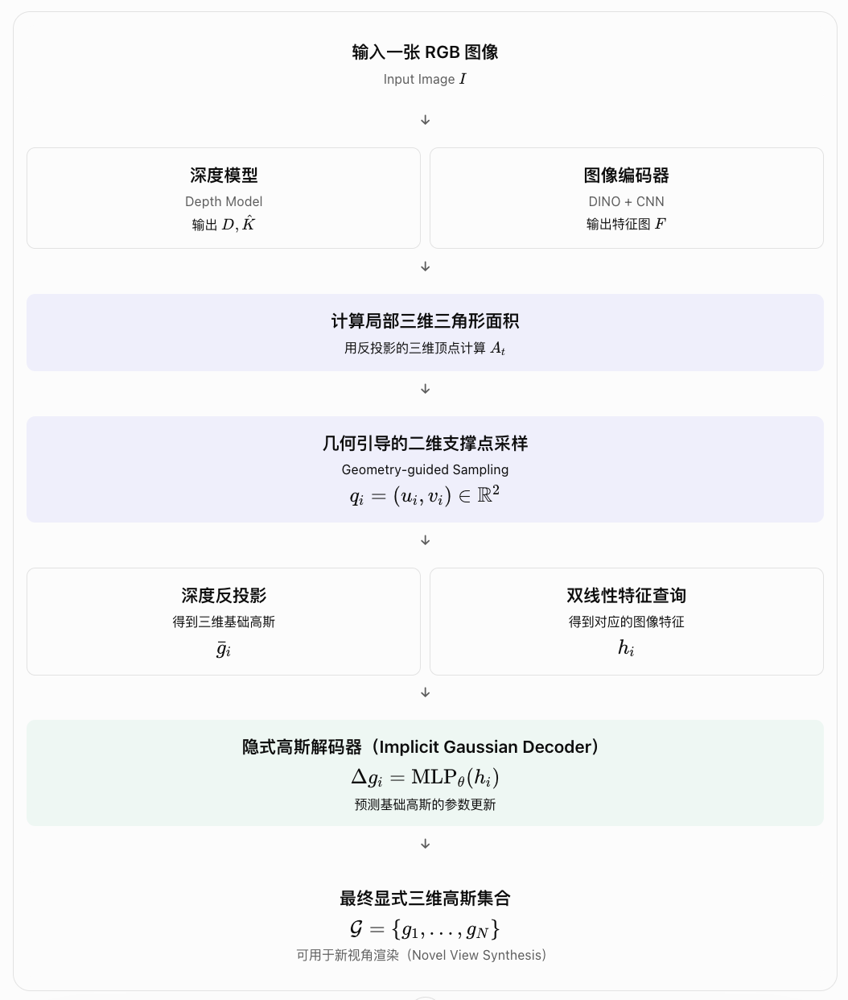
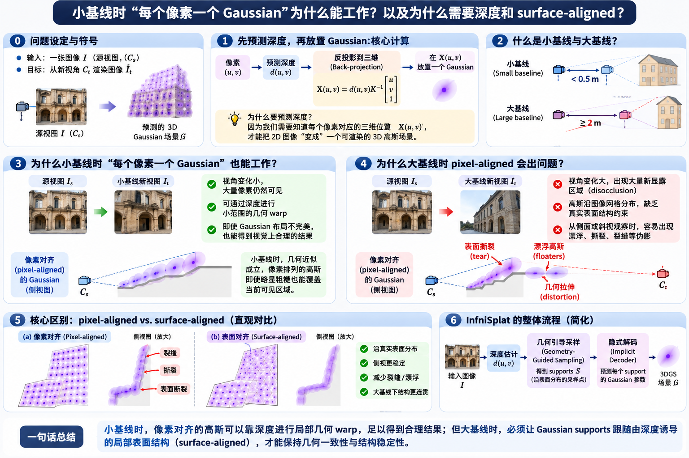
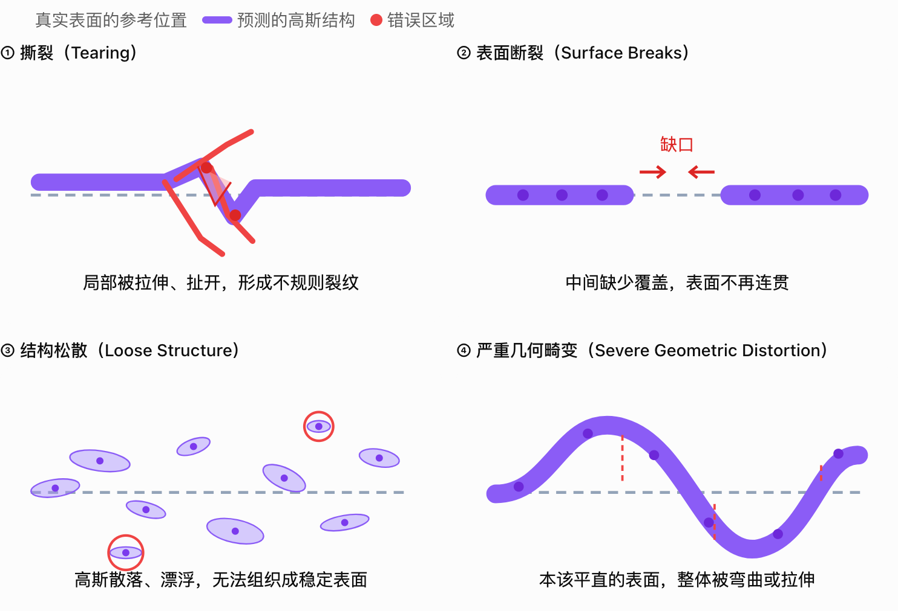
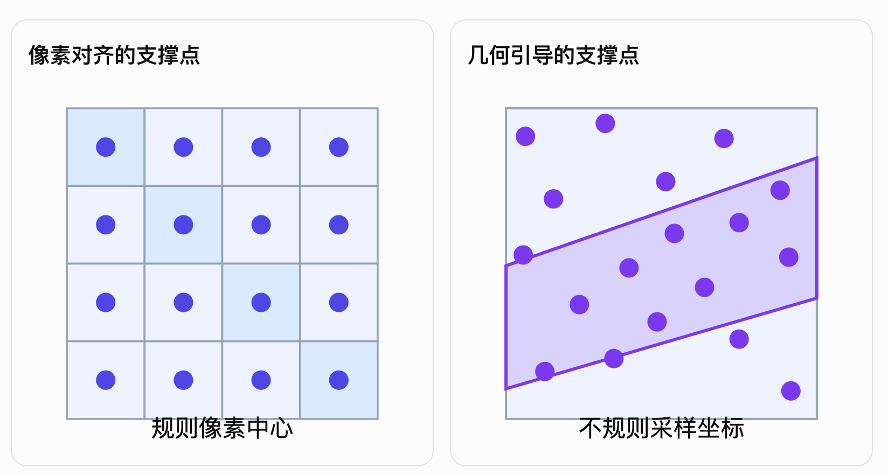
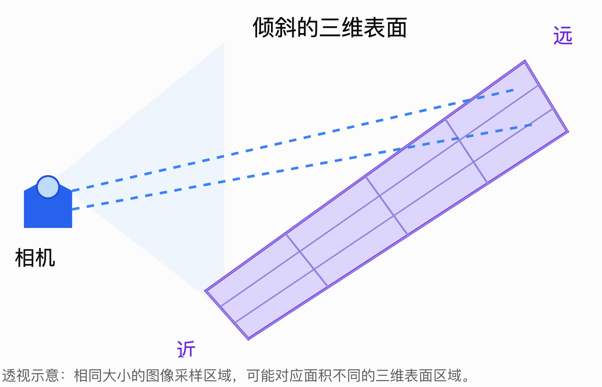

## 1. 摘要

单图前馈三维高斯泼溅的目标，是仅从一张输入图像直接生成一个可渲染的三维场景表示，从而避免多视图采集以及**针对每个场景**进行优化（per-scene optimization）的开销。然而，现有方法通常受到**像素对齐表示**（pixel-aligned representation）的限制：它们从**固定图像网格位置**预测高斯原语（Gaussian primitives）。这种像素对齐的原语在输入视角附近能够生成令人满意的渲染结果，但它们与真实场景表面的耦合较弱，因此当视点发生较大变化时，难以维持连贯一致的结构。

本文提出 **InfiniSplat**，一种前馈式单图 3DGS 框架，其目标是将表示方式从**像素对齐**（pixel-aligned）推进到**表面对齐**（surface-aligned）。InfiniSplat 首先使用**几何引导采样**（geometry-guided sampling），依据深度所诱导的局部表面结构来放置二维支撑点（2D supports）；随后使用**查询条件隐式解码器（query-conditioned implicit decoder）**，在这些支撑位置查询图像特征，并据此预测高斯属性。

通过让支撑位置落在几何结构上，同时将高斯预测从固定像素中心中解耦，InfiniSplat 能够生成更加遵循真实场景表面的高斯布局，并减少由规则网格离散化（grid discretization）造成的散乱高斯原语。在多个跨数据集（cross-dataset）的新视图合成评测中，InfiniSplat 相较于现有单图前馈基线取得了最先进的结果，并展示出从 Hypersim 室内合成训练数据零样本泛化（zero-shot generalization）到复杂开放世界场景的能力。



## 2. 核心insight

InfiniSplat 将单图前馈 3DGS 从“逐像素回归（per-pixel regression）”重新参数化为“在几何自适应支撑上的连续查询式高斯场（query-conditioned Gaussian field）”。

## 3. 3DGS基础和基线

一个三维高斯可以理解成空间中的一个“有方向、有大小、有颜色、有透明度的椭球小云团”。

第 $i$ 个高斯通常包含：

$$
g_i=(\mu_i,s_i,r_i,c_i,\alpha_i).
$$

分别表示：

- $\mu_i\in\mathbb R^3$：三维中心；
- $s_i\in\mathbb R^3$：三个主轴方向上的尺度；
- $r_i$：旋转，一般用四元数（quaternion）表示；
- $c_i$：颜色或球谐系数（Spherical Harmonics, SH）；
- $\alpha_i$：不透明度。

### 3.1 高斯的协方差矩阵

三维 Gaussian 的形状可以写成协方差矩阵：

$$
\Sigma_i
=
R_i
\begin{bmatrix}
s_{i,x}^2&0&0\\
0&s_{i,y}^2&0\\
0&0&s_{i,z}^2
\end{bmatrix}
R_i^T.
$$

其中 $R_i$ 由四元数 $r_i$ 转换得到。

如果：

$$
s_x=s_y=s_z,
$$

高斯就是球形；

如果：

$$
s_z\ll s_x,s_y,
$$

它就是一个很薄的椭圆片，比较像局部表面片。

因此，如果 3DGS 真正学到了场景表面，一个常见现象是高斯会变得像许多小“薄片”，共同覆盖真实表面。

### 3.2 3DGS如何渲染

三维 Gaussian 被投影到目标相机后，变成二维椭圆 Gaussian。

设投影函数为：

$$
u=\pi(X).
$$

在高斯中心附近线性化投影，使用投影 Jacobian：

$$
J=\frac{\partial\pi}{\partial X}.
$$

则三维协方差近似投影为二维协方差：

$$
\Sigma_{2D}
\approx
J\Sigma_{3D}J^T.
$$

之后，高斯会在屏幕空间“splat”成一个椭圆区域。

多个高斯按照深度排序后进行 alpha compositing（透明度累积）：

$$
C(p)
=
\sum_i T_i(p)\alpha_i(p)c_i,
$$

其中：

$$
T_i(p)=\prod_{j<i}(1-\alpha_j(p)).
$$

直觉上：

- 前面的 Gaussian 先贡献颜色；
- 越被前面遮挡，后面高斯的透射权重越小。

这就是为什么 3DGS 可以实时渲染。

### 3.3 为什么之前的单图前馈3DGS喜欢pixel-aligned prediction?

因为卷积网络和 Vision Transformer 的特征本来就定义在二维图像网格上。

最简单的设计是：

$$
F\in\mathbb R^{H'\times W'\times C}
$$

然后对每一个网格位置 $(x,y)$ 输出：

$$
[\mu,s,r,c,\alpha].
$$

也就是说：

```text
image pixel / feature pixel
         ↓
       Gaussian
```

这个方案有三个优点：

1. 实现简单；
2. GPU 上非常适合 dense tensor；
3. 每个输出位置天然对应输入图像上的局部区域。

但它有一个根本缺陷：

> **二维图像网格的规则性是相机成像坐标系的规则性，不是三维场景表面的规则性。**

InfiniSplat 就是从这一点切入。

### 3.4 大基线和小基线



传统双目/多视图几何里，我们通常说：

$$
\text{baseline}=\|\mathbf C_1-\mathbf C_2\|
$$

即两个**真实拍摄相机中心**之间的距离。

比如你做结构恢复（SfM）：

$$
I_1,I_2
$$

分别由相机 $C_1,C_2$ 拍摄，那么：

$$
B=\|C_1-C_2\|
$$

这时候确实至少需要两张输入图像，才能谈“输入图像之间的基线”。

但是 InfiniSplat 是**单图像新视角合成（single-image novel view synthesis）**。它说的 baseline 是：

$$
\boxed{
B_{\text{NVS}}
=
\|\mathbf C_{\text{target}}-\mathbf C_{\text{source}}\|
}
$$

其中：

- $\mathbf C_{\text{source}}$：唯一输入图片对应的真实相机；
- $\mathbf C_{\text{target}}$：你希望从哪里看这个场景，也就是**虚拟的新视角相机**。

给定单张图像 InfiniSplat 根据它预测一个三维高斯场景：

$$
I_s
\xrightarrow{f_\theta}
\mathcal G
$$

得到：

$$
\mathcal G=\{g_1,g_2,\dots,g_N\}
$$

然后你把虚拟相机稍微向右移动 5 cm：

$$
C_s \rightarrow C_{t1}
$$

这是**小基线（small baseline）**。

如果移动 20 cm：

$$
C_s \rightarrow C_{t2}
$$

是中等视角变化。

如果虚拟相机移动 1～2 m：

$$
C_s \rightarrow C_{t3}
$$

这就是 InfiniSplat 所说的**大基线新视角（large-baseline novel view）**。

#### InfiniSplat 的实验其实把“大基线”定义得非常具体

把 source-target camera baseline 按真实相机位姿分成：

$$
[0,0.5)
$$

$$
[0.5,1)
$$

$$
[1,2)
$$

$$
[2,+\infty)
$$

单位是米。

也就是说：

$$
\boxed{
\text{source camera}
\rightarrow
\text{target camera}
}
$$

移动超过 **2 m** 的样本，会进入论文最困难的大基线区间。论文每个测试数据集挑选 512 个 source-target pair，并在四个 baseline 区间各取约 128 对。

#### 为什么小基线容易，大基线突然很困难？

这是理解 InfiniSplat 最重要的一点。

假设相机只移动一点：

$$
\Delta C \approx 0
$$

那么新视角和原图高度重叠。

大量像素可以近似理解成：

$$
\text{warp}(I_s,D)
$$

也就是说：

> 有一张深度图 + 输入图片，做一点几何变换就已经能骗得很像。

因此很多 single-image 3DGS 方法即使学到的并不是特别好的三维结构，也能在附近视角获得不错结果。

### 3.5 四类错误

{width=760px}

| 错误类型 | 核心表现 | 可能原因或空间组织特点 | 直观例子 |
| --- | --- | --- | --- |
| **撕裂（Tearing）** | 局部结构被不规则拉扯、拉伸或撕开，可能出现细丝、扭曲、分叉或错位；不一定有空白缺口 | 相邻高斯中心位置不一致，尺度或旋转预测不合理，或局部深度估计出现错误变化 | 笔直窗框从侧面看被拉成细长线条，边缘像被撕开 |
| **表面断裂（Surface Breaks）** | 本应连续的表面覆盖被中断，出现裂缝、孔洞或不连续边界 | 高斯分布密度、尺度、不透明度或位置不合适，导致部分区域覆盖不足 | 一堵墙只覆盖了左右两部分，中间出现空白或断层 |
| **结构松散（Loose Structure）** | 高斯没有紧密组织成稳定表面，表现为漂浮物、散乱分布或模糊表面；即使没有明显孔洞也可能存在 | 高斯散布在表面前后，尺度不一致，或独立漂浮在空间中 | 墙面区域仍有覆盖，但墙前墙后分布着许多散乱高斯 |
| **严重几何畸变（Severe Geometric Distortion）** | 整体或大范围形状、比例、相对位置错误；即使表面连续，几何仍可能错误 | 深度先验错误、单目重建的尺度或形状歧义、错误的位置更新，或仅适合输入视角的几何 | 直墙变弯、建筑立面扭曲、桌子被拉长，或垂直柱子弯曲 |

**撕裂强调局部形态被拉扯，表面断裂强调覆盖不连续，两者可以同时发生。**3DGS 本身没有严格的网格拓扑，这里的“断裂”描述渲染结果或高斯空间组织的连续性缺失，并不意味着三角网格中的边被切断。

其中最重要的一点是：

$$
\boxed{
\text{几何连续（Geometric Continuity）}
\neq
\text{几何正确（Geometric Accuracy）}
}
$$

例如，一个完整但被错误弯曲的墙面，可能没有任何裂缝，但几何仍然不准确。

同样，一个大致位于正确位置的墙面，也可能因为高斯覆盖不足而出现大量孔洞。

#### 为什么这些问题在小基线时不明显，而大基线时暴露？

一个重要原因是**投影造成的错误掩盖（Projection-induced Error Masking）**。

假设源相机正对墙面，高斯沿视线方向稍微分散。

从正面观察时：

- 位于墙前方和后方的高斯可能投影到相近的像素；
- 它们的颜色经过透明度合成后，仍然能够近似重建输入图像；
- 因而三维组织错误不一定会在 RGB 图像中明显出现。

但目标相机向侧面移动后，原本沿视线方向重叠的高斯会产生视差（Parallax），其空间位置差异就逐渐暴露。

可以用针孔相机的简单模型理解。

假设三维点深度为 $Z$，相机横向平移距离为 $B$，且相机朝向保持不变，则该点在图像中的水平位移幅度近似为：

$$
|\Delta u|\approx\frac{fB}{Z}
$$

其中：

- $f$：焦距（以像素为单位）；
- $B$：相机横向基线；
- $Z$：点的深度。

当 $B$ 增大时，视差增大。不同深度的高斯投影位置分离得更加明显。

所以一组在源视角中看似重叠良好的高斯，在侧视角可能突然呈现为不同层次、孔洞或分散结构。

这就是为什么作者特别强调**大基线新视图合成（Large-baseline Novel View Synthesis）**。

## 4. InfiniSplat

### 4.1 重要的几何直觉：同样一个像素，对应的三维表面积不同

假设针孔相机：

$$
\tilde p=
\begin{bmatrix}
x\\y\\1
\end{bmatrix}.
$$

若深度为 $z$，则反投影：

$$
X=zK^{-1}\tilde p.
$$

考虑两个相邻像素：

$$
p_1=(x,y),\qquad p_2=(x+1,y).
$$

它们的三维距离近似与深度 $z$ 成正比：

$$
\|X_2-X_1\|\propto\frac{z}{f}.
$$

所以物体越远，一个像素覆盖的世界空间越大。

如果表面还发生倾斜，则会进一步受到透视缩短（foreshortening）影响。

因此一个固定像素格子对应的真实三维面积大致不是常数，而会随：

- 深度；
- 表面倾角；
- 相机焦距；
- 局部几何变化；

而改变。

这就是为什么作者计算：

$$
A_t=\frac12\|(X_b-X_a)\times(X_c-X_a)\|.
$$

它实际上是在估计：

> **这一小块二维图像区域，在三维世界里到底覆盖了多大面积？**

面积越大，就应该分配越多 Gaussian supports。

### 4.2 为什么深度不连续处要删除三角形？

假设一个像素属于前景椅子，旁边像素属于背景墙：

```
camera
   |
   |    chair point ●
   |
   |                         wall point ●
```

如果把这两个点和第三个像素点连成三角形，会生成一个跨越巨大空域的“假表面”。

三角形面积可能异常大，于是采样器还会误以为这里需要大量高斯。

所以作者先检查三角形三个顶点之间的相对深度变化，若变化过大就丢弃。

这本质上是在使用一个非常经典的先验：

> **图像邻域不一定对应三维表面邻域，尤其在 occlusion boundary（遮挡边界）上。**

### 4.3 支撑点是什么？和高斯中心的区别？

{width=580px}

左边，支撑点只能来自规则的像素中心，例如：

$$
(0,0),(1,0),(2,0),\ldots
$$

右边，支撑点可以是连续的二维坐标：

$$
(0.35,0.72),(1.24,2.56),\ldots
$$

这些新坐标不是随便选的，而是由预测深度对应的**局部三维表面积**决定采样概率。

这里的二维支撑 $q_i$ 可以理解为：

> “我要在输入图像中的这个连续坐标位置，放置一个候选 Gaussian，并从这里读取图像特征。”

它首先是一个二维 query：

$$
q_i=(u_i,v_i).
$$

再利用深度：

$$
D(q_i)
$$

反投影成基础三维位置：

$$
\bar\mu_i=\Pi^{-1}(q_i,D(q_i);K).
$$

所以：

```text
2D support
   ↓ depth
3D base Gaussian center
```

这样做的好处是：所有图像特征本来就在二维 feature map 上，因此 query 坐标既可以用于几何定位，也可以用于 feature sampling。

### 4.4 什么叫“锚定于几何”？

考虑一个倾斜的墙面。

相机观察这个墙面时，近处的物理区域在图像中通常占据更多像素，远处的同样大小物理区域则占据更少像素。

所以，**二维图像中的均匀采样，不等于三维物体表面上的均匀采样。**

{width=580px}

InfiniSplat 的做法是：

**第一步：** 利用深度图（Depth Map）将每个像素反投影到三维空间：

$$
\mathbf X(u,v)=D(u,v)K^{-1}[u,v,1]^\top
$$

**第二步：** 把相邻像素对应的三维点连接成局部三角形，计算其面积：

$$
A_t=\frac12\left\|
(\mathbf X_b-\mathbf X_a)\times
(\mathbf X_c-\mathbf X_a)
\right\|
$$

**第三步：** 根据面积决定分配多少个支撑点：

$$
w_t=\frac{A_t}{\sum_j A_j}
$$

举个例子，假设两个图像三角形对应的三维面积分别是：

$$
A_1=1\text{m}^2,\quad A_2=4\text{m}^2
$$

如果一共分配 100 个采样点，那么按面积比例，预期会分配：

$$
N_1\approx20,\quad N_2\approx80
$$

这就是“几何引导（Geometry-guided）”的含义：**分配多少支撑点，由三维几何覆盖需求决定，而不只是由图像像素数量决定。**

不过论文并不是直接在三维表面上任意生成点，而是根据三维三角形面积，在对应的二维图像三角形内采样，然后再通过深度反投影获得三维位置。

### 4.5 为什么改成 irregular support 后，就需要 implicit decoder？

传统 dense decoder 可以直接输出：

$$
Y[x,y,:].
$$

但 InfiniSplat 的支撑是：

$$
q_1=(13.28,40.17),
$$

$$
q_2=(92.51,18.63),
$$

$$
q_3=(92.77,18.91),
$$

这些坐标：

- 不是整数；
- 不是规则间隔；
- 每个局部区域支撑数量不同。

因此输出必须变成：

$$
g_i=f_\theta(q_i,I).
$$

这就是“隐式函数（implicit function）”的核心思路：

> 网络不输出一个固定大小的 dense grid，而是给定任意 query coordinate，返回该坐标处的预测结果。

类似：

$$
\text{LIIF}:\quad (q,F)\mapsto RGB(q),
$$

$$
\text{InfiniDepth}:\quad (q,F)\mapsto D(q),
$$

而 InfiniSplat 是：

$$
\boxed{
(q,F,\bar g)\mapsto\Delta g
}
$$

因此它不是“implicit scene representation”意义上的 NeRF；它是**implicit decoding function**，最终输出仍然是显式 Gaussian primitives。

这是一个容易混淆但非常重要的点。

### 4.6 DINO 分支到底在做什么？

DINO 是一种自监督视觉 Transformer（self-supervised Vision Transformer）表征。

它最重要的能力不是精确恢复纹理，而是形成稳定的高层视觉语义：

- 哪些像素属于同一个物体；
- 哪些区域具有相同语义；
- 哪些结构在不同图像域中仍然对应；
- 局部 patch 的高层类别/部件关系。

因此 $F^{\mathrm{dino}}$ 更像：

```text
“这里是墙面”
“这里是桌子边缘”
“这里属于同一辆车”
“这两个 patch 在语义上相关”
```

而不是：

```text
“这里 RGB 精确是多少”
```

为什么 cross-dataset 泛化特别依赖 DINO？

因为 Hypersim 是合成数据，而 ScanNet++ 等是真实图像，二者在：

- 材质；
- 光照；
- 噪声；
- 色彩分布；

上差异明显。

高层语义特征通常比低层 RGB 纹理对 domain shift 更鲁棒。

所以去掉 DINO 后 ScanNet++ PSNR 从：

$$
22.240\rightarrow12.501,
$$

这是非常合理的现象。

---

### 4.7 CNN 分支为什么仍然需要？

如果 DINO 很强，为什么还要 CNN？

因为 DINO 的 patch token 通常空间分辨率相对低，而且更偏高层语义。

3DGS 的渲染却非常依赖：

- 精细颜色；
- 边缘；
- 小纹理；
- 局部高频细节。

所以 CNN 分支提供：

$$
F^{\mathrm{cnn}}
$$

作为 low-level appearance cue。

可以把二者理解成：

```text
DINO：这是什么、这一片应该连起来
CNN ：这里具体长什么样、边缘在哪
```

因此：

$$
\text{DINO}=\text{结构/语义泛化 backbone},
$$

$$
\text{CNN}=\text{局部纹理/边界补偿}.
$$

---

### 4.8 为什么不用直接拼接 DINO 和 CNN，而要 gated fusion？

简单 concat：

$$
h=[f^{dino},f^{cnn}]
$$

当然也可以。

论文使用门控：

$$
\alpha=\sigma(W_g[f^{dino},\tilde f^{cnn}]),
$$

$$
h=\alpha\odot f^{dino}+(1-\alpha)\odot\tilde f^{cnn}.
$$

这相当于对每个通道学习一个软开关：

$$
\alpha_k\in[0,1].
$$

如果：

$$
\alpha_k\approx1,
$$

第 $k$ 个通道主要依赖 DINO；

如果：

$$
\alpha_k\approx0,
$$

主要依赖 CNN。

所以它比固定加权更灵活。

---

### 4.9 为什么不直接预测三维偏移 $\Delta X\in\mathbb R^3$？

论文预测：

$$
\Delta u\in\mathbb R^2
$$

和：

$$
\Delta z\in\mathbb R.
$$

再反投影。

这是一个很聪明的参数化。

因为基础 Gaussian 已经来自：

$$
(q_i,D(q_i)).
$$

它天然属于输入相机的成像射线。

如果直接预测任意：

$$
\Delta X=(\Delta X,\Delta Y,\Delta Z),
$$

网络可以把 Gaussian 随意推到三维空间中，容易破坏 geometry scaffold。

而使用：

```text
图像平面小位移 Δu
+
沿视线方向的小深度调整 Δz
```

相当于告诉网络：

> “你可以修正深度先验，但不要完全抛弃它。”

也就是：

$$
\text{strong initialization}
+
\text{bounded local correction}.
$$

这符合残差学习（residual learning）的思想。

### 4.10 为什么颜色、opacity、scale 要在 inverse-activation space 更新？

假设 opacity 必须满足：

$$
\alpha\in(0,1).
$$

如果直接：

$$
\alpha=\bar\alpha+\Delta\alpha,
$$

就可能得到：

$$
\alpha=1.4
$$

或者：

$$
\alpha=-0.2.
$$

都是非法值。

更好的方法是让：

$$
\alpha=\sigma(a),
$$

其中 $a\in\mathbb R$ 无限制。

基础 opacity：

$$
\bar a=\sigma^{-1}(\bar\alpha).
$$

网络在无约束空间更新：

$$
a'=\bar a+\lambda\Delta a,
$$

最后：

$$
\alpha'=\sigma(a').
$$

无论 $a'$ 多大或多小：

$$
0<\alpha'<1.
$$

这就是论文统一公式：

$$
g^{(a)}=\psi_a(\psi_a^{-1}(\bar g^{(a)})+\lambda_a\Delta g^{(a)}).
$$

对于 scale，常见 $\psi$ 是指数函数：

$$
s=\exp(\hat s),
$$

因此永远：

$$
s>0.
$$

---

### 4.11 为什么需要 Gaussian regularization？

仅靠图像渲染损失存在一个问题：

> 很多不同的 Gaussian 参数组合，可以渲染出相似图像。

例如：

- 一个很大的低 opacity 高斯；
- 很多个小高 opacity 高斯；

可能在某一视角产生相似 RGB。

但它们在新视角下的稳定性完全不同。

因此需要约束参数本身。

#### Scale regularization

约束：

$$
\ell_{min}\le\log s_i\le\ell_{max}.
$$

防止：

- Gaussian 过大：像“雾”一样覆盖大片区域；
- Gaussian 过小：产生碎片化、高频噪声和孔洞。

#### Local smoothness

如果两个支撑相邻，通常认为它们属于同一局部表面，则：

$$
s_i\approx s_j,
$$

$$
\alpha_i\approx\alpha_j.
$$

这是一种局部平滑先验。

值得注意的是：它并没有强制颜色平滑。

原因很简单：真实表面可以有高频纹理，但几何尺度和透明度通常应该比颜色更平滑。

---

### 4.12 InfiniSplat 到底有没有真正“恢复完整三维场景”？

严格来说：**没有。**

它生成的是一个从单个输入视角出发、适合一定视点范围内 NVS 的 3D Gaussian representation。

单图看不到的区域仍然不可能被纯几何恢复。

因此需要区分重建与生成，以及 InfiniSplat 在两者上的能力：

| 维度 | Reconstruction（重建） | Generation / Hallucination（生成 / 幻觉） |
| --- | --- | --- |
| 目标 | 恢复真实存在的三维几何 | 对不可见区域，根据先验猜测合理内容 |
| InfiniSplat 的主要能力 | 将**可见 / 近可见区域**的几何组织得更稳定 | 对未见区域具有有限的学习先验补全能力 |
| 能力边界 | 局部几何更稳定，不等于恢复完整场景 | 大范围遮挡解除（large disocclusion）时仍可能失败，论文图 11 展示了此类情况 |

因此不应该把它理解为：

> “一张图恢复真实世界完整 360° geometry”。

更准确是：

> “一张图生成一个适合大于邻近视角范围的新视图渲染的显式 3DGS proxy”。

### 4.13 为什么 Hypersim 训练可以泛化到真实场景？

理论上这是很困难的，因为 synthetic-to-real domain gap 很大。

InfiniSplat 能泛化的关键可能来自三个来源：

1. **DepthPro**：在大规模真实数据上学到的几何先验；
2. **DINOv3**：强通用视觉语义特征；
3. 3DGS decoder 只需要学习“如何根据这些通用先验组织 Gaussian”。

因此，虽然 Gaussian decoder 在 Hypersim 上训练，输入给 decoder 的 feature space 已经是高度通用的 pretrained representation。

这也是为什么去掉 DINO 会严重崩溃。

## 5. 从信息流角度重新理解 InfiniSplat

把整个系统拆成信息来源：

### Geometry stream {.unlisted}

$$
I
\xrightarrow{DepthPro}
(D,\hat K)
\xrightarrow{backprojection}
\text{3D local surface}
\xrightarrow{area sampling}
q_i,\bar\mu_i.
$$

回答：

> **在哪里放 Gaussian？**

### Semantic stream {.unlisted}

$$
I\xrightarrow{DINO}F^{dino}.
$$

回答：

> **这个位置属于什么结构、应该和谁保持一致？**

### Appearance stream {.unlisted}

$$
I\xrightarrow{CNN}F^{cnn}.
$$

回答：

> **这里具体是什么颜色、纹理、边缘？**

### Decoder {.unlisted}

$$
(q_i,F^{dino},F^{cnn},\bar g_i)
\rightarrow
\Delta g_i.
$$

回答：

> **基于初始几何，在这里应该怎样微调 Gaussian？**

这四块拼起来，你就真正理解了整个模型。

## 6. 公式与数学原理

### 6.1 相机模型与反投影公式

针孔相机中，一个三维点：

$$
X=(X,Y,Z)^T
$$

投影到图像：

$$
\begin{bmatrix}
u\\v\\1
\end{bmatrix}
\sim
K
\begin{bmatrix}
X/Z\\Y/Z\\1
\end{bmatrix}.
$$

内参矩阵通常为：

$$
K=
\begin{bmatrix}
f_x&0&c_x\\0&f_y&c_y\\0&0&1\end{bmatrix}.
$$

如果知道像素：

$$
p=(u,v)
$$

和相机坐标系中的 $Z$-depth：

$$
z=D(p),
$$

则：

$$
X(p)=zK^{-1}
\begin{bmatrix}
u\\v\\1
\end{bmatrix}.
$$

把它展开：

$$
X=z\frac{u-c_x}{f_x},
$$

$$
Y=z\frac{v-c_y}{f_y},
$$

$$
Z=z.
$$

因此论文写成抽象形式：

$$
X(p)=\Pi^{-1}(p,D(p);\hat K).
$$

其中 $\Pi^{-1}$ 就是反投影。

### 6.2 为什么三角形面积用叉乘？

三角形三个三维顶点：

$$
A=X(p_a),\quad B=X(p_b),\quad C=X(p_c).
$$

从 $A$ 出发两条边：

$$
a=B-A,
$$

$$
b=C-A.
$$

向量叉积：

$$
a\times b
$$

的模长等于以 $a,b$ 为邻边的平行四边形面积：

$$
\|a\times b\|
=
\|a\|\|b\|\sin\theta.
$$

三角形面积是平行四边形一半：

$$
A_t
=
\frac12\|a\times b\|.
$$

所以论文公式自然得到：

$$
A_t
=
\frac12
\|(X_b-X_a)\times(X_c-X_a)\|_2.
$$

---

### 6.3 为什么面积权重可以近似“表面采样密度需求”？

假设总共准备采样 $N$ 个支撑点。

第 $t$ 个局部表面三角形面积 $A_t$。

总面积：

$$
A=\sum_t A_t.
$$

如果希望在三维表面上近似均匀地按面积采样，那么第 $t$ 个三角形应该分配：

$$
n_t\approx N\frac{A_t}{A}.
$$

定义：

$$
w_t=\frac{A_t}{\sum_{t'}A_{t'}}.
$$

则：

$$
n_t\approx Nw_t.
$$

这其实就是 Monte Carlo sampling 中非常标准的 importance allocation 思路。

---

### 6.4 如何在二维三角形内部均匀采样？

论文没有详细展开采样算法，但理解它很有用。

给定三角形二维顶点：

$$
p_a,p_b,p_c.
$$

一种常见均匀采样方法：

$$
r_1,r_2\sim U(0,1),
$$

令：

$$
u=1-\sqrt{r_1},
$$

$$
v=\sqrt{r_1}(1-r_2),
$$

$$
w=\sqrt{r_1}r_2.
$$

则：

$$
u+v+w=1,
$$

采样点：

$$
q=up_a+vp_b+wp_c.
$$

这给出三角形内部均匀分布。

注意这部分是理解 area-weighted sampling 的标准数学实现，论文正文没有明确规定必须采用这一具体算法。

---

### 6.5 双线性插值（Bilinear Sampling）到底怎么算？

support $q_i$ 通常不是整数坐标。

假设：

$$
q=(x,y),
$$

且：

$$
x_0=\lfloor x\rfloor,
\quad
x_1=x_0+1,
$$

$$
y_0=\lfloor y\rfloor,
\quad
y_1=y_0+1.
$$

定义：

$$
a=x-x_0,
$$

$$
b=y-y_0.
$$

则 feature：

$$
F(q)
=
(1-a)(1-b)F(x_0,y_0)
+a(1-b)F(x_1,y_0)
$$

$$
\quad+
(1-a)bF(x_0,y_1)
+abF(x_1,y_1).
$$

这使 $F(q)$ 关于坐标 $q$ 几乎处处可微，因此 support 坐标与网络参数能够一起参与梯度传播。

---

### 6.6 门控融合的数学解释

论文：

$$
\alpha_i=\sigma(W_g[f_i^{dino},\tilde f_i^{cnn}]).
$$

假设 feature dimension 为 $C$：

$$
\alpha_i\in(0,1)^C.
$$

第 $k$ 通道：

$$
h_{i,k}
=
\alpha_{i,k}f^{dino}_{i,k}
+
(1-\alpha_{i,k})\tilde f^{cnn}_{i,k}.
$$

这是一个凸组合（convex combination），因为：

$$
0<\alpha_{i,k}<1.
$$

因此每个通道的融合值位于两个 feature value 的加权组合之间，不会像 unrestricted linear fusion 那样任意放大。

从优化角度看，这是一种“soft feature selection”。

---

### 6.7 为什么高斯更新输出正好 14 维？

论文：

$$
\Delta g_i
=(\Delta u_i,\Delta z_i,\Delta s_i,\Delta r_i,\Delta c_i,\Delta\alpha_i).
$$

逐项：

| 属性                    |   维度 |
| ----------------------- | -----: |
| 图像平面位置 $\Delta u$ |      2 |
| 深度 $\Delta z$         |      1 |
| scale $\Delta s$        |      3 |
| quaternion $\Delta r$   |      4 |
| RGB $\Delta c$          |      3 |
| opacity $\Delta\alpha$  |      1 |
| **总计**                | **14** |

因此：

$$
2+1+3+4+3+1=14.
$$

---

### 6.8 四元数（Quaternion）为什么用 4 维表示旋转？

三维旋转可以用单位四元数：

$$
q=(w,x,y,z),
$$

满足：

$$
w^2+x^2+y^2+z^2=1.
$$

它有 4 个参数，但只有 3 个自由度，因为有单位范数约束。

相较欧拉角：

- 不容易出现万向锁（gimbal lock）；
- 数值优化更连续。

所以网络直接预测 4 维向量，然后归一化：

$$
q'=\frac{\hat q}{\|\hat q\|_2}.
$$

再转换为旋转矩阵 $R$。

---

### 6.9 为什么 scale 用 log-space？

高斯尺度必须满足：

$$
s_i>0.
$$

令：

$$
\hat s_i=\log s_i,
$$

则：

$$
s_i=e^{\hat s_i}.
$$

无论 $\hat s_i$ 是任意实数，$s_i$ 永远为正。

而且乘法尺度变化会变成加法：

$$
s'=ks
$$

对应：

$$
\log s'=\log s+\log k.
$$

所以在 log-space 优化尺度往往更加稳定。

这也解释论文为什么正则：

$$
\log s_i.
$$

---

### 6.10 Scale regularization 是怎样工作的？

公式：

$$
\mathcal L_{scale}
=
\frac1N\sum_i
[
\mathrm{ReLU}(\ell_{min}-\log s_i)
+
\mathrm{ReLU}(\log s_i-\ell_{max})
].
$$

分三种情况。

#### 情况 1

$$
\ell_{min}\le\log s_i\le\ell_{max}
$$

则两项都是 0：

$$
L=0.
$$

#### 情况 2：scale 太小

$$
\log s_i<\ell_{min}.
$$

第一项：

$$
\ell_{min}-\log s_i>0.
$$

产生惩罚。

#### 情况 3：scale 太大

$$
\log s_i>\ell_{max}.
$$

第二项产生惩罚。

所以这是一个“软盒约束（soft box constraint）”。

论文设置：

$$
[-8,-3].
$$

对应 scale 大致范围：

$$
[e^{-8},e^{-3}]
\approx
[0.000335,0.0498]
$$

在归一化 Gaussian scale space 中。

---

### 6.11 Local smoothness 正则到底在鼓励什么？

$$
\mathcal L_{smooth}
=
\frac1N\sum_i
\frac1{|N(i)|}
\sum_{j\in N(i)}
\left(
\|\log s_i-\log s_j\|_1
+
|\alpha_i-\alpha_j|
\right).
$$

如果邻居 $i,j$ 的尺度和 opacity 相近：

$$
L\approx0.
$$

如果一个 Gaussian 极薄、另一个突然极大，或者一个透明一个不透明，就会产生较大 penalty。

它隐含一个局部平稳假设：

> 同一个局部 surface patch 上的 Gaussian geometry 应该平滑变化。

注意，这种 smoothness 只在 support neighborhood 上定义，因此它实际上也依赖几何引导采样得到的局部结构。

---

### 6.12 感知损失中的 VGG feature loss

像素 L1：

$$
\|\hat I-I\|_1
$$

要求像素颜色逐点接近。

但大基线 NVS 中，即使几何大体正确，小量错位也会导致 L1 很大。

VGG feature：

$$
\phi_l(I)
$$

对局部纹理、形状和语义具有一定不变性。

因此：

$$
\|\phi_l(\hat I)-\phi_l(I)\|_2^2
$$

更关心感知结构。

---

### 6.13 Gram matrix 是什么？为什么能约束纹理？

假设某层 VGG feature：

$$
F\in\mathbb R^{C\times HW}.
$$

Gram matrix：

$$
G=FF^T.
$$

其中：

$$
G_{ij}=\sum_p F_{i,p}F_{j,p}.
$$

它描述不同 feature channel 之间的相关性。

它弱化了严格空间位置，而保留纹理统计，因此在风格迁移（style transfer）中非常经典。

论文使用：

$$
\|G_l(\hat I)-G_l(I)\|_F^2
$$

帮助目标渲染保持更接近真实图像的纹理统计。

---

### 6.14 PSNR 的数学意义

均方误差（Mean Squared Error, MSE）：

$$
\mathrm{MSE}
=
\frac1M\sum_p(I_p-\hat I_p)^2.
$$

若像素归一化到 $[0,1]$：

$$
\mathrm{PSNR}
=10\log_{10}\frac{1}{\mathrm{MSE}}.
$$

因此 PSNR +3 dB，大致意味着 MSE 减半：

$$
10\log_{10}2\approx3.01\,\mathrm{dB}.
$$

所以 InfiniSplat 在某些数据集上 +3~4 dB 的改善是比较显著的。

---

### 6.15 SSIM 与 LPIPS 分别看什么？

| 指标 | 比较方式 | 主要关注 |
| --- | --- | --- |
| **PSNR** | 基于两张图像之间的像素均方误差（MSE）衡量重建质量 | 像素重建的准确程度 |
| **SSIM**（结构相似度） | 比较局部亮度、对比度和结构 | 局部结构相似性，相比单纯 MSE 更关注视觉结构 |
| **LPIPS**（感知距离） | 将两张图像输入预训练深度网络，比较特征距离 | 深层特征所反映的感知差异 |

论文同时报告这三项指标，从**像素重建、局部结构和深层感知**三个角度比较，比单独使用 PSNR 更全面。

## 7. 总结

现有单图前馈三维高斯方法通常在固定像素中心预测高斯，因此二维规则采样并不对应均匀、连续的三维表面采样，大幅视点变化后会暴露裂缝与碎片。InfiniSplat 用单目深度反投影估计局部三维表面积，按照面积自适应地采样二维支撑点，再在任意支撑位置查询 DINO 和 CNN 特征，通过共享隐式 MLP 预测高斯参数残差。这样高斯分布更符合局部表面结构，并在跨数据集大基线新视图合成中获得更稳定的结构和更好的图像指标。

> **去掉几何引导采样（Geometry-guided Sampling）的数值下降其实远小于去掉 DINO 的下降**。因此，“表面对齐表示”是论文最漂亮的 conceptual contribution，但模型跨数据集泛化能力的最大实际来源之一，很可能仍然是强大的预训练视觉语义先验。

## 8. 论文写作学习

InfiniSplat 的写法有一个非常值得学的模式：


<div class="research-flow">
<div class="research-flow-step">现象：near-view 很好，但 large-baseline 会裂</div>
<div class="research-flow-arrow" aria-hidden="true">↓</div>
<div class="research-flow-step">诊断：不是单纯 network capacity，而是 pixel-aligned representation</div>
<div class="research-flow-arrow" aria-hidden="true">↓</div>
<div class="research-flow-step">提出目标：pixel-aligned → surface-aligned</div>
<div class="research-flow-arrow" aria-hidden="true">↓</div>
<div class="research-flow-step">产生两个技术要求：<br>1. support 应该跟 surface 走<br>2. decoder 必须支持 irregular support</div>
<div class="research-flow-arrow" aria-hidden="true">↓</div>
<div class="research-flow-step">对应两个模块：<br>1. geometry-guided sampling<br>2. implicit Gaussian decoding</div>
<div class="research-flow-arrow" aria-hidden="true">↓</div>
<div class="research-flow-step">实验验证每个模块 + large-baseline qualitative evidence</div>
</div>


这是比“我们用了 A+B+C 所以更好”更成熟的研究叙事。
